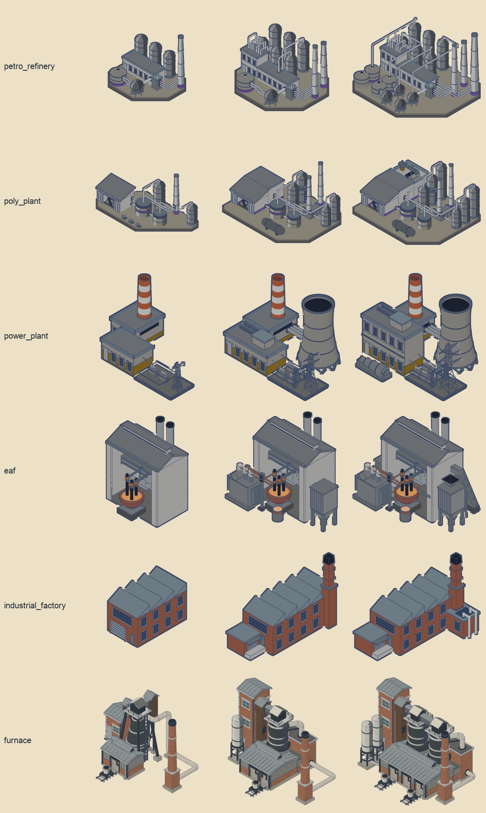
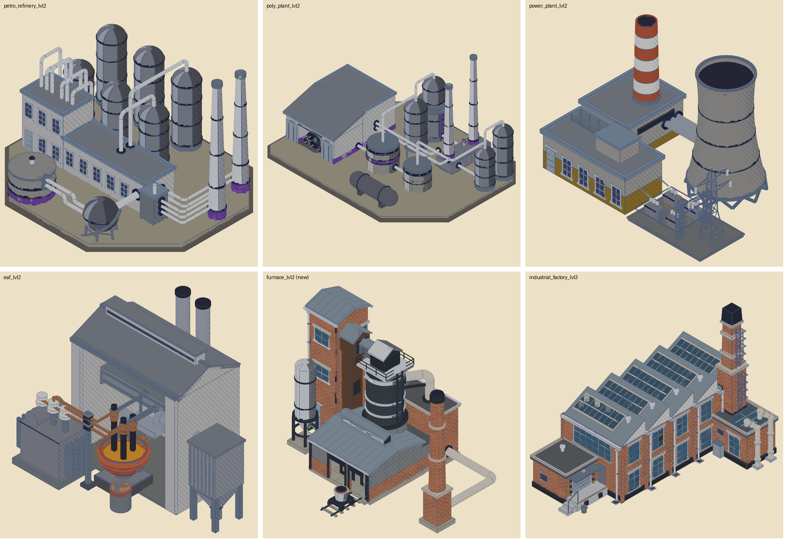

# Rebuilding the refinery, polymerisation refinery, power plant and EAF — 17 October 2026

An assessment, not built. It applies what the furnace rebuild established
(`docs/reviews/furnace-v2-2026-10-16.md`, and the "catalogue look" and "installing a building
for both views" sections of `.claude/skills/blender-building-sprites/SKILL.md`) to the next
four industrial buildings.

## Where the four stand today

All four share the same three gaps.

- **No catalogue look in 3D.** Their builders use the old kit greys (`wall_shell`,
  `wall_grey`, `roof`, `roof_deck`, `drum`, `column`), and their models were exported before
  the pattern-code exporter: the 3D manifest records no `span` for them. The print shader
  therefore draws them flat, with no coursing, seams, gravel or panel joints, beside a
  factory and furnace that have all of these.
- **Old 2D print.** Their sprites carry the August `stylize_shade` halftone; the furnace now
  carries the Paper WPA print.
- **Flows not audited.** `BUILDING_NOTES.md` marks the power plant and both refineries "not
  yet flow-audited". The EAF was audited in August.

| Building | Recipes | Builder | Triangles L1 / L2 / L3 | Notes on record |
| --- | --- | --- | --- | --- |
| Petrochemical refinery | 15: crude distillation and cracking, fuels, coking, ethylene, methane, hydrogen, methanol, silica washing, coke calcination | 743 lines | 13,798 / 33,360 / 50,060 | L1 is the owner's own composition; L2 and L3 still carry the older layout. Heaviest building in the game. |
| Polymerisation refinery | 4: plastics, rubber, PVC, depolymerisation | 460 lines | 18,052 / 25,184 / 31,668 | Shares the refinery's vocabulary; warehouse with rolls of finished goods is its signature. |
| Power plant | 7: coal, oil, gas, methane, hydrogen, coke and waste-to-power | 298 lines | 4,604 / 12,284 / 15,288 | L1 has no cooling tower by owner decision; hall, transformers and pylon read as the power flow. |
| Electric arc furnace | 9: steel, aluminium, silicon, graphite, copper, concrete | 888 lines | 7,120 / 9,074 / 10,606 | The eave is solved from the electrode sightline; caster annex hidden at L3; roof is the biggest mass. |

## Two ways to do each one

**Restyle** keeps the approved composition and changes what the furnace showed matters:
material names and colours from the catalogue table, brick base courses stacked under
cladding, factory windows with stone lintels, membrane flat roofs, standing-seam pitched
roofs, gutters and downpipes, white pipework, the outer contour, and the Paper WPA sprite
print. It also covers fixing the layout problems already on record. Cost: roughly a day per
building, mostly review.

**Rebuild** writes a new builder in the frozen-revision pipeline, as the furnace was. Only
worth it where the composition itself is wrong or out of date.

## Recommendation, per building

**Power plant — restyle first.** It is the smallest builder and the most generic already:
seven fuels, one thermal plant. Keep the cooling tower, the hall, the transformer compound
and the pylon in their power-flow line. Make the hall brick on a base course with factory
windows and a membrane roof; replace the red-and-white banded flue with a brick chimney like
the furnace's and the factory's, so the set shares one chimney language; add a coal and fuel
store that reads for any fuel (a covered bunker and one tank) and close the fuel → boiler →
turbine → transformer → pylon flow. Owner decisions: keep the mustard power dado as the one
accent, keep or retire the banded flue, and keep L1 towerless.

**EAF — restyle.** It is the furnace's sibling, and the furnace now sets that family's
look: dark iron, refractory cladding on a brick base course, monitor roof, brick lift tower,
thin chimney. Give the melt shop that cladding and a monitor ridge, which also breaks up its
oversized roof; keep the solved eave and the bowl sightline, which are the design; move the
L3 caster annex where the camera sees it; replace the rotary valve cube with a proper airlock
or remove it. Its flows were audited, so the risk is low.

**Petrochemical and polymerisation refineries — rebuild as a pair.** The petro plant's L2
and L3 were never reworked to match its owner-approved L1, it is the heaviest model in the
game, and its pipework is where an open flow is most likely. Write one shared refinery module
(the way `furnace_v2_builder.py` runs after `furnace_builder.py`), keep the petro L1
composition and the poly plant's warehouse and floating-roof vats as the anchors, and build
L2 and L3 of both from them: a distillation column and process units on a pipe rack, a tank
farm in a bund, a flare (petro only), a brick control building with factory windows. Keep
purple as the category accent on tank bands. Set a triangle budget near the furnace's
(about 20,000 at L3). Flow-audit every line: crude in → column → products to tanks → out.

## Order and cost

1. **Power plant**, to prove the restyle path on the smallest builder.
2. **EAF**, which completes the metallurgy family with the furnace.
3. **The refinery pair.**

Each install is the furnace's chain: build → masks and anchors → models → install → far,
medium and lit bakes with `--asset-keys` → import → tests → 3D and rear review. The legacy
builders run through `bake_sprite.py`; moving them into `tools/building_assets/pipeline.py`
(add to `FAMILIES` and `PAPER_FAMILIES`, an exporter spec from `DETAIL_SOURCE`, an fx script
like `furnace_v2_fx.py`) is part of the first one.

**The map package must be rebaked after each install that changes a model's size.** The
package's scenery key includes every standing building's model dimensions and the continent
key its far-sprite span (`world_builder.gd`), so any change in width, depth, height or span
makes all 600 tiles stale. A fresh process then rebuilds them before Begin: measured after
the furnace install at **377 s to Begin, 604 cache misses** against the stale package. The
furnace's production rebake took **21 minutes**, after which Begin returned to 19.5 s. Batch rebuilds that land together into one
rebake, and never ship an install without it.
