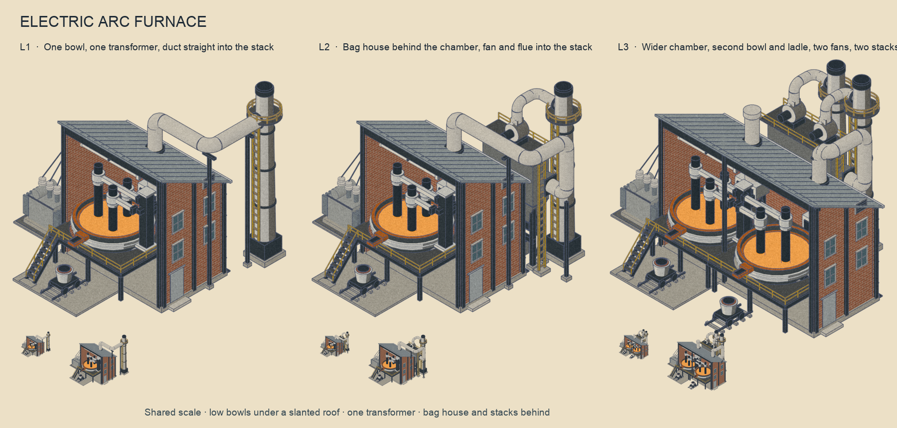
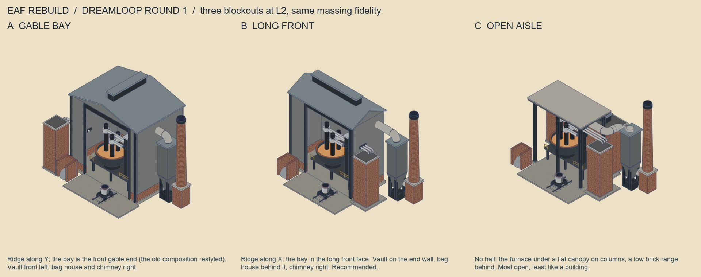
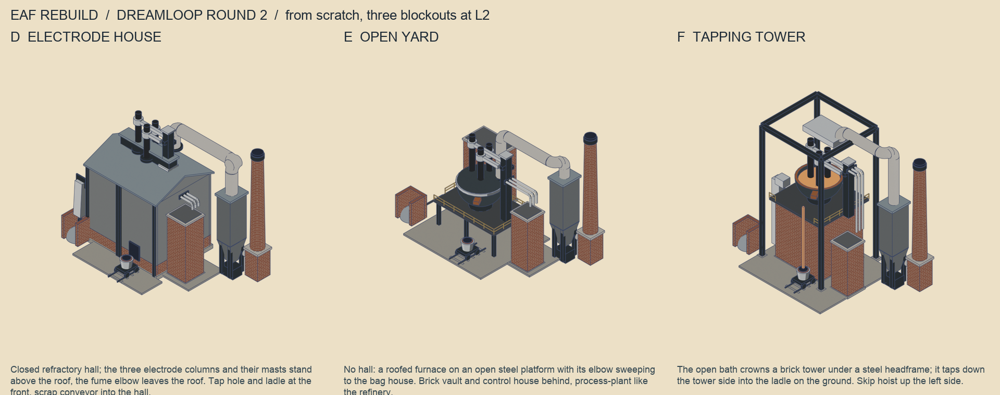
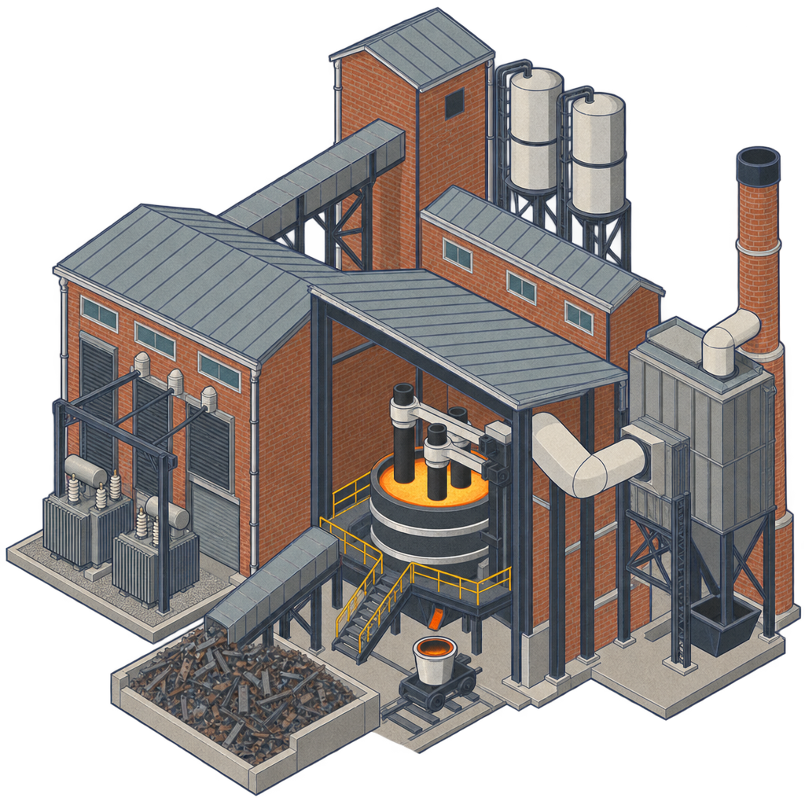
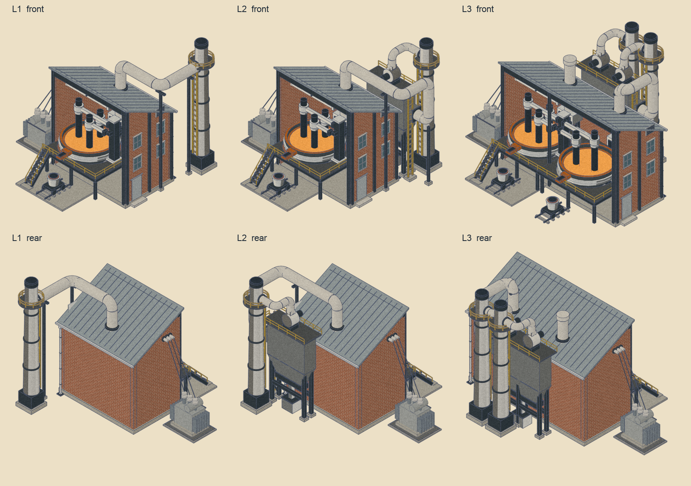
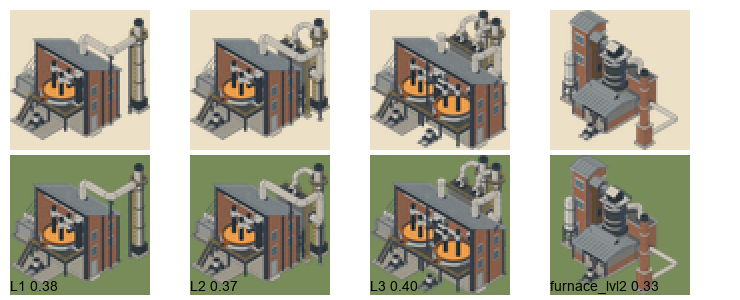
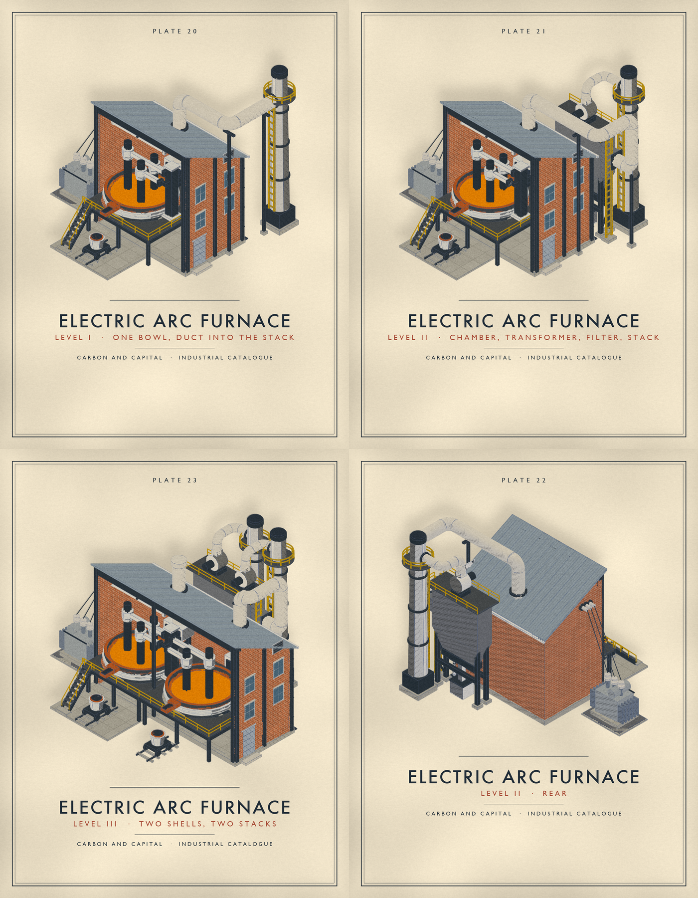
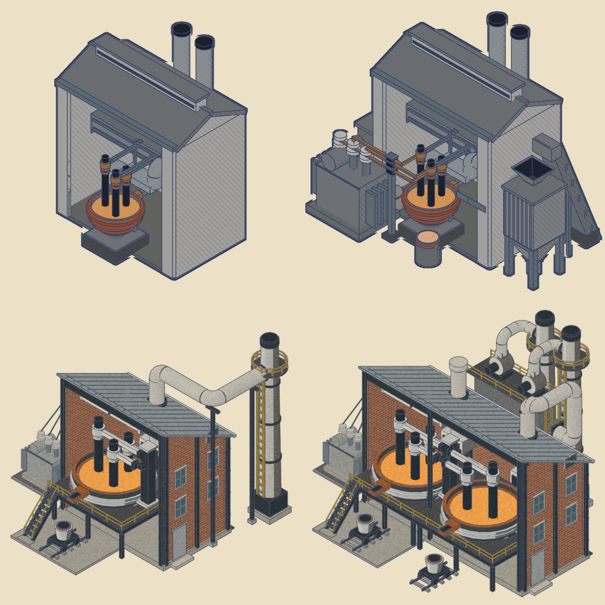

# Electric arc furnace, rebuilt in the catalogue look — 20 October 2026

The EAF is the furnace's sibling and shares its vocabulary: brick walls with factory
windows, a standing-seam roof, dark-metal vessels with silver hoops, black-grey decks
with yellow rails, white process ductwork, a yard transformer and warm-white steel stacks.
After nine owner directions it is also the simplest of the catalogue buildings: only the
furnace, the building over it and what the furnace needs. Built with
`tools/building_assets/eaf_v2_builder.py`, staged as family `eaf_v2`, installed as `eaf`.



## Dreamloop

Two rounds of massing blockouts, three per sheet at the same fidelity, before the detail
was spent.



Round 1 kept the old idea of a shed with an open bay round a bowl: A gable bay (the old
composition restyled), B long front, C open aisle. B was built, installed and checkpointed
on the branch (commit "Rebuild the electric arc furnace in the catalogue look"). The owner
then asked for a rebuild from scratch, not close to the old model.



Round 2 abandoned the bay: D electrode house (a closed hall with the electrode columns above
the roof), E open yard (a roofed furnace on an open platform), F tapping tower (the open bath
on a brick tower under a headframe). **The owner chose D, with a larger bath and a back
building for hoppers, storage and power.** That was built and installed (the bath open above
the roof of a closed house); on seeing it the owner asked for the furnace back inside as in
the old model, under a single slanted roof plane over the process chamber angled so the bowl
stays visible, brick sides with windows, the transformers on one side and the centre of the
picture the bowl; then two brick towers flanking the chamber with three rows of two windows and an engineering
pass; then, on seeing that, the right tower dropped so the left could widen into a proper
transformer house with larger transformers, the scrap bay and crane removed because they did
not read, and the bag house given a side inlet and a top outlet because the duct dropping
into its lid read as piercing a hopper. Then, on the next look: the bag house still read as a
hopper with pipes in it, so it was redrawn as a filter; the transformer house moved back and
merged with the rear range into an L so the switchyard in front could grow and its
transformers with it; the bowl lowered and enlarged with the operating deck raised around it;
the brick chimney replaced by a taller modern steel stack at the back; and the scrap heap
replaced by a closed receiving bin, because an arc furnace takes many inputs. Then, on the
next look: the house and the storage range merged into one L under one roof; the silos
replaced by a single water tank at the back; the receiving bin given a proper frame; the
elevator, which had nothing legible to raise, moved to the yard so the chain reads bin,
conveyor, elevator, gallery, chute; the chamber's windows moved into the bays between its
columns; and the bag house given a ladder from the ground with a gap in its barrier. Then
the owner suggested swapping the flue and the filter, so the stack stands at the front right
in the open at every level and the bag house behind it, with the water tank raised onto a
tower so it still shows above the filter. Then the owner asked whether L3 could have two
bowls, and on hearing that the sprite's width left no room, simplified the whole layout:
stacks at the back, one or two by level, with the condenser between them and the furnace,
one large transformer on the left, and nothing that is not the furnace or the building
over the bowl. No lift, no store, no switchyard, no tower. That cleared the width for a
second shell at L3. That is the installed build. The blockout builders stay in
`tools/building_assets/eaf_v2_dreamloop.py`.

One image-model concept was made for the last direction, after the owner asked to see one:



The brief and the request record are in `outputs/eaf-v2-2026-10-20/sunburst/`. It confirmed
the house as a substation building (louvred bays, transformer doors, a framed switchyard) and
suggested a low concrete-walled scrap yard in place of the brick bay, which the build does not
yet have.

## The plant

| Part | What it is |
| --- | --- |
| Process chamber | An open portal front under a dark fascia with dark jamb columns, brick side walls under the roof's fall (the right one with two rows of two factory windows in the bays between its three dark columns, a louvre and a door), a brick back wall, and one slanted roof plane, high at the open front and dropping to the back, with standing seams down the fall, a beam under the front edge, a gutter at the low back eave and a downpipe. Because the roof falls away from the viewer the front eave alone decides what is seen. L3 widens the chamber to the right for the second shell, with a third front column at the mast. |
| Power | One large oil-filled transformer on kerbed gravel left of the open front, three leads from its bushings up to porcelain bushings on the chamber's left wall; inside, bus bushings carry the tubes across the chamber above the electrodes to the mast's terminals, hung from the roof midway. |
| Furnace | Large and low: the dark-metal shell on a rocker pedestal with trunnions, a refractory lip and two silver hoops, the bath baked as light, forward in the chamber. The operating deck is raised around it, a black-grey annular floor whose hole follows the shell, on dark columns, with yellow rails on its open edges and a straight stair down to the yard. Three graphite electrodes with silver clamps on arms from a dark mast right of the shell. The spout at the front of the rim tips into a launder over the deck's edge, directly over the ladle car. At L3 a second shell hangs off the other side of the same mast, with its own three electrodes, hood, spout, launder, deck bay and ladle car. |
| Fume | A hood at the back of each rim on its own stand; the duct rises through the roof with a collar, runs back over the roof's right part at one height (the second hood's riser tees into it), drops behind the chamber on a post and lands on the bag house's flanged inlet at its lit end. L1 has no filter: the duct runs straight back into the stack through a collar, on posts. |
| Bag house | Behind the chamber, drawn to read as a filter: a wide plain clad box on tall dark legs with ring beams and bracing, so the box shows over the back eave; the flanged inlet transition on its lit end, a top walkway with a yellow barrier and the caged ladder from the ground up that end, an induced-draught fan with its motor and outlet on the lid (two fans at L3, when the box is wider), and a hopper with a rotary valve and motor and a dust chute into a lidded bin on the ground. |
| Stacks | Behind the bag house: a modern steel stack, dark plinth, warm-white tapered steel shell with dark bands, an access platform with a yellow barrier near the top, a caged ladder up its front, a dark cap. One at every level in the same place behind the filter's lit end; a second at L3 behind its left half. Each fan's clean flue rises and runs back into its stack through a collar. |
| Tapping | The furnace family's ladle car on rails under the launder; a second car under the second launder at L3. |

Flows: transformer → leads → wall bushings → bus tubes → mast → arms → electrodes → bath;
bath → spout → launder → ladle car; fume → hood → duct → bag house (in at the end) → fan
(out at the top) → flue → stack; dust → hopper → rotary valve → chute → bin; rain → gutter →
downpipe → drain.

Fixed across levels: the transformer, the furnace and its mast, the first stack. L1: one
bowl, the duct straight into the stack. L2: bag house. L3: wider chamber, second bowl and
ladle, wider bag house with two fans, second stack.

## Engineering pass

Every part was checked for what carries it, where its flow starts and ends, and whether the
joint is drawn.

- Fume: hood on its own stand at each rim; duct through the chamber roof with a collar;
  post at the eave (L1, L2) or a stand on the roof (L3) under the run; post under the drop;
  flanged inlet transition on the bag house; fan on the lid with its outlet on top; clean
  flue into the stack through a collar; dust hopper, rotary valve with its motor, chute,
  lidded bin on the ground. L1's duct into the stack on two posts with saddles.
- Power: the transformer on kerbed gravel; leads from its bushings to porcelain wall
  bushings with flanges; inner-wall bushings and tubes hung from the roof midway; terminals
  on the mast; arms with roots and brackets; clamps and rings on the electrodes.
- Tapping: spout and launder from each rim over the deck's edge, directly over its ladle car.
- Deck: annular floor on columns with fascia beams, rails on its open edges, stair with
  stringers, handrails and a foot pad; at L3 two bays meeting at the mast.
- Furnace: rocker pedestal and trunnions, two water-cooled hoops, refractory lip and lining.
- Bag house: feet, legs, two ring beams and bracing under the box; walkway and barrier with a
  gap at the ladder; the ladder from the ground.
- Stacks: footing, plinth, bands, platform with barrier, caged ladder.
- Rainwater: gutter and downpipe to a drain at the chamber's back eave.
- Not drawn, because the camera cannot see it from this side: the cooling-water flow and
  return to the hoops, the slag door at the back of the shell and the tilt cylinders.

## Rear view and readability



The rear shows the chamber's slanted roof from its low side with its gutter and downpipe,
the hoods' ducts over the roof, the bag house's back on its legs with the hopper and bin,
the stacks' rear with the flues entering them, and the transformer with its leads up the
left wall. Nothing floats and nothing ends in a roof slope.



## Measurements

| | L1 | L2 | L3 | Old L3 |
| --- | ---: | ---: | ---: | ---: |
| Triangles | 10,544 | 12,830 | 20,098 | 10,606 |
| Edge density at 70 px | 0.38 | 0.37 | 0.40 | — |
| Raw sprite width / height (limit 688 px) | 652 / 564 | 652 / 564 | 656 / 666 | — |

The furnace sits at 0.32 to 0.37 edge density; the EAF sits just above it, the brick
coursing and the transformer's fins the finest parts, and L3's two shells the densest. L1
and L2 are now at the old model's triangle count; L3 is twice it, for two shells and two
stacks. L1 and L2 are compact; L3's wider chamber and back stacks use the full height.

## Lessons that apply to other buildings

- **A roof that falls away from the viewer costs nothing in visibility.** With the eave high at
  the open front and low at the back, the front eave alone decides what is seen: the ray from
  any point inside rises one unit per unit toward the front while the roof rises less, so the
  check is the same sightline test as for a flat head.
- **Anything placed to the right of an opening hides its interior.** From this camera the
  right wall, pier or wing is nearer than everything inside; the mast and the bowl's right edge
  must have a smaller x+y than the right jamb. The transformer side therefore went left.
- **Anything behind the house is invisible unless it rises above the roof line.** A back
  range at the house's eave height vanished entirely; a tower taller than the ridge, silos
  on tall frames and a head house read. Check `v = (2z − x + y)` against the ridge before
  placing plant behind a building.
- **The sprite's width is max(x+y) − min(x+y) over the actual geometry**, about 88 px per
  unit at this scale, pads included. Keep it under 10.7 units for the 688 px limit, pave as
  touching rectangles that follow the plant, and remember that the tallest object at the
  back-left and the front pad corner set the height.
- **The sprite's height is max(2z − x + y) − min(2z − x + y).** Plant behind a building is
  the most expensive place for a tall thing, and a wide building is the most expensive
  thing at the front: L3's wider chamber lowered the front-right corner, and the stacks
  behind the filter had to come down to 5.6 to fit. A site pad that runs to the front
  across the whole width costs the same as the building would.
- **A mast or column beside the vessel must have a smaller x+y than anything that could
  stand in front of it on screen**, or its arms appear to end in a wall.
- **A dreamloop for a building is three massing blockouts at the same fidelity on one
  labelled sheet**; a detailed candidate beside two blockouts biases the choice. Two rounds
  were needed here: the first stayed too close to the old model.
- `review_sheet.py` reads the rear renders from `review/reverse/`; write
  `review_reverse.py`'s output there. A family's `fires=` in `building_fx.py` names the
  objects that get the arc hot spot; only the rest of the light mask breathes.
- In zsh an unquoted `$args` string is one argument: build Godot argument lists with
  `set --`, or the plate tool gets a bogus asset key and a null mesh.

## Installation





**What was installed** (revision `outputs/eaf-v2-2026-10-20/v14`):

| Layer | Files |
| --- | --- |
| 2D sprites | `assets/icons/buildings/sprites/eaf_lvl{1,2,3}.png`; provenance in `detailed_buildings_manifest.json` (`staged_as: eaf_v2`) |
| 2D effects | `assets/fx/windows/` and `assets/fx/light/eaf_lvl{1,2,3}.png`; stack smoke and the baths' arc hot spots in `ANCHORS["eaf"]` (`scripts/empire_fx.gd`) |
| 3D models | `assets/supply_chain_3d/eaf_lvl{1,2,3}.glb` and `_contour.glb`; entries in its `manifest.json` (span 8.08) |
| 3D impostors and picking | far, medium and lit atlases and `picking/eaf_lvl{1,2,3}.res`, baked with `--asset-keys` |

**Reproduce.** From the game project:

```sh
python3 tools/building_assets/pipeline.py build --revision <rev> --families eaf_v2 --output <dir>
blender --background --factory-startup --python tools/building_assets/building_fx.py -- <dir>/<rev> eaf_v2
python3 tools/building_assets/package_building_fx.py <dir>/<rev> eaf_v2
python3 tools/building_assets/pipeline.py models --revision <rev> --output <dir>
python3 tools/building_assets/pipeline.py install --revision <rev> --output <dir>
godot --headless --editor --import --quit --path .
AGENT_GODOT_WINDOW=1 godot --path . res://tools/supply_chain_3d/bake_far_sprites.tscn -- --asset-keys=eaf_lvl1,eaf_lvl2,eaf_lvl3 --no-telemetry
AGENT_GODOT_WINDOW=1 godot --path . res://tools/supply_chain_3d/bake_far_sprites.tscn -- --medium --asset-keys=eaf_lvl1,eaf_lvl2,eaf_lvl3 --no-telemetry
AGENT_GODOT_WINDOW=1 godot --path . res://tools/supply_chain_3d/bake_medium_lighting.tscn -- --asset-keys=eaf_lvl1,eaf_lvl2,eaf_lvl3 --no-telemetry
godot --headless --editor --import --quit --path .
```

The anchors written by `package_building_fx.py` (`fx/anchors_eaf.json`) go into `ANCHORS["eaf"]`.
Rear views: `review_reverse.py` into `<rev>/review/reverse/`, then `review_sheet.py`. 3D check:
`catalog_plate.tscn --asset=eaf_lvl2` (and `--yaw=180`) after the install's import, or a trial
export in `assets/supply_chain_3d_trial/` with a renamed `manifest.json`, imported, with `--dir`.

**Verification.**

- The far and medium atlases and the lit atlas record the installed GLBs' SHA-256 for all
  three levels; the lighting bake wrote the three picking resources.
- 3D plates of the installed models, front and rear, beside the furnace and the factory:
  brick coursing on every base course and the tower, panel joints on the housing and the
  cladding, standing seams, gravel on the vault and wing roofs; nothing shows through a wall.
- Coplanar check (L3): only same-material corners remain (the chamber's wall junctions, the
  kit transformer on its plinth, the spouts on the linings, the bag house's legs on their
  beams).
- Parse check: 1,035 scripts, 0 failed.
- Unit suite: 7,698 passed, 17 failed, the known main baseline (road roll-out, Stoneshore,
  river climbs, the building catalogue count, a pending save, trees, foundations, and
  far/medium bakes that are stale for other families). None names the EAF; the EAF's far,
  medium and lit bakes match the installed models.

**The map package.** The world holds standing EAFs, and `world_builder.gd` keys every tile on
its standing buildings' model dimensions and far-sprite spans, so the install stales the
continent package and the company-start supplement. Measured on the first (direction B)
install in a fresh process with an empty user directory
(`profile_startup.tscn -- --continent-review --combined-open --all-tiles-on-start`):
Begin offered at 77.0 s, first 3D open 2 bundled hits / 27 misses / 37 writes, continent
load 0 / 604 / 605, combined opening ready after 1,274.5 s. `bake_continent_package.tscn`
refuses to run without `--approved-continent-bake`, which it reserves for explicit owner
approval; the owner chose to commit without the rebake for now. The rebake sequence (continent
package with scenery reuse and prune, validate, world snapshot, company start High and Low
until settled, validate, fresh profile) is the one in `docs/load-time-bakes.md`.
