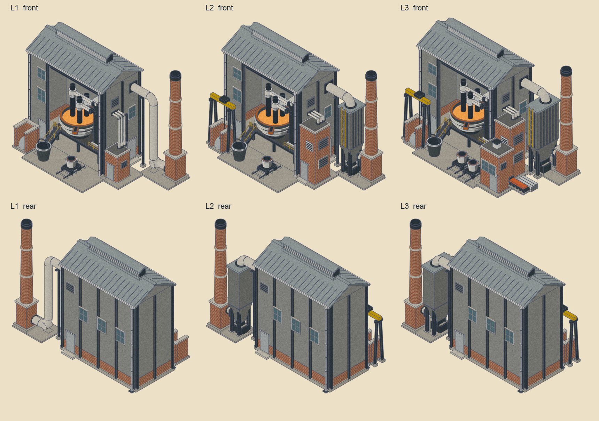

# Electric arc furnace, rebuilt in the catalogue look — 20 October 2026

The EAF is the furnace's sibling, so it now shares the furnace's vocabulary: a refractory
melt shop on a brick base course with a louvred monitor roof and standing seams, a dark-metal
shell with silver water-cooled hoops, black-grey operating decks with yellow rails, a brick
transformer vault, white fume ductwork, a bag house on a dark frame and one thin black-topped
brick chimney in the same place at every level. Built with `tools/building_assets/eaf_v2_builder.py`,
staged as family `eaf_v2`, installed as `eaf`.


## Dreamloop

Three compositions at the same massing fidelity, one sheet, before any detail was spent:


- **A, gable bay.** The old composition restyled: ridge along Y, the bay in the front gable
  end. Keeps the old flaw: the roof's long slope is the sprite's largest single mass.
- **B, long front.** Ridge along X, the bay in the long front face. The bay frames the
  furnace, the monitor and the bay's height break the roof, and the vault, bag house and
  chimney line up as one flow to the right. Chosen and built.
- **C, open aisle.** No hall: the furnace under a flat canopy on columns in front of a low
  brick range. The most open view of the furnace, but it stops reading as a building and the
  canopy is a flat slab as large as A's roof.

The blockout builders stay in `tools/building_assets/eaf_v2_dreamloop.py`.

## The plant

| Part | What it is |
| --- | --- |
| Melt shop | Refractory cladding on a brick base course, dark portal columns on the wall faces, standing-seam roof with the ridge along X and a louvred monitor, gutters on both eaves with downpipes to drains. The long front face carries the open charging bay under a dark lintel; the left pier has factory windows and a door, the end wall a window, door and louvre, the back wall three windows, a door and a louvre. |
| The eave | Solved, not chosen: the lowest eave that shows the bath, every electrode tip and the mast through the bay (`_e_solve_eave`), the head being the lintel's underside. One unit of depth costs one unit of height, so the furnace stands forward in the shop. |
| Furnace | Open dark-metal shell on a rocker pedestal, refractory lip, three silver hoops, a tapping spout at the front right, the bath as baked light. Three graphite electrodes with silver clamps on arms from a dark mast at the lit side. |
| Operating platform | Black-grey deck on dark columns, yellow rails along the front either side of the shell, a straight stair with yellow handrails climbing through the bay's left edge from the yard. |
| Transformer vault | Brick, stone coping, membrane roof, cooling louvres on the lit faces, a door; three roof bushings from which the bus tubes run over the roof into the shop's end wall and on to the mast's terminals. L1 has a low switch kiosk in the same place with the tubes rising on a post. |
| Fume | Canopy hood in the roof space; the duct leaves the end wall high up on a post, into the bag house's lid; cleaned gas leaves the bag house's right face into the chimney base. L1 has no bag house: the duct drops to the ground and runs into the chimney as a low flue, as the furnace's L1 does. |
| Bag house | Clad filter box on a dark frame, hopper into a skip, yellow caged ladder on the front. L3 deepens it toward the front. |
| Chimney | The furnace family's chimney: brick base, stone plate, tapered brick barrel with stone bands, dark cap, black top. Same place at every level. |
| Scrap | Brick scrap bay open to the front with the heap showing over its walls, a charging bucket beside the stair, and from L2 a yellow goliath crane over the bay with its grab on the heap. |
| Tapping | The furnace family's ladle car on rails in front of the tapping side; a second car at L3. |
| Caster (L3) | Brick annex with a membrane roof at the front right; the glowing strand leaves its lit end wall on rollers, cut billets stacked beside it. |

Flows: scrap bay → crane → bucket → bath; vault → bus tubes → mast → arms → electrodes →
bath; bath → spout → ladle car; fume → hood → duct → bag house → flue → chimney; dust →
hopper → skip; rain → gutters → downpipes → drains; L3: ladle → caster → strand → billets.

Fixed across levels: the shop and its eave, the furnace, the mast, the chimney and the
vault's place. L1: kiosk, ground flue, no crane. L2: full vault, bag house, goliath crane.
L3: caster annex and billets, second ladle, deeper bag house.

## Rear view and readability



The rear shows the pilastered back wall with its windows, door and louvre, both gutters and
the back downpipe, the vault's back louvre, the bag house's back, and the crane. Nothing
floats and nothing ends in a roof slope.

## Measurements

| | L1 | L2 | L3 | Old L3 |
| --- | ---: | ---: | ---: | ---: |
| Triangles | 11,648 | 12,166 | 13,606 | 10,606 |
| Edge density at 70 px | 0.32 | 0.32 | 0.33 | — |
| Raw sprite width (limit 688 px) | 662 | 670 | 670 | — |

The furnace sits at 0.32 to 0.37 edge density; the EAF matches it.

## Lessons that apply to other buildings

- **The sprite's width is a budget of max(x+y) − min(x+y) over the actual geometry**, about
  88 px per unit at this scale, pads included. Keep it under 10.7 units for the 688 px limit,
  pave as touching rectangles that follow the plant, and remember that a front-right annex is
  the lowest screen point and sets the height.
- **A mast beside the furnace must sit left of the bay's jamb on screen** (its x+y below the
  jamb's), or the pier hides it and the arms appear to end in the wall.
- **A dreamloop for a building is three massing blockouts at the same fidelity on one
  sheet.** A detailed candidate beside two blockouts would bias the choice.
- `package_building_fx.py` used to turn the whole light mask into one breathing fire. A
  family's `fires=` list in `building_fx.py` now names the objects that get the arc's
  shifting hot spot (the bath), and only what is left of the light mask breathes.
- `review_sheet.py` reads the rear renders from `review/reverse/`; point
  `review_reverse.py` there.

## Installation


**What was installed** (revision `outputs/eaf-v2-2026-10-20/v3`):

| Layer | Files |
| --- | --- |
| 2D sprites | `assets/icons/buildings/sprites/eaf_lvl{1,2,3}.png`; provenance in `detailed_buildings_manifest.json` (`staged_as: eaf_v2`) |
| 2D effects | `assets/fx/windows/` and `assets/fx/light/eaf_lvl{1,2,3}.png`; chimney smoke, the bath's arc hot spot and (L3) the breathing strand in `ANCHORS["eaf"]` (`scripts/empire_fx.gd`) |
| 3D models | `assets/supply_chain_3d/eaf_lvl{1,2,3}.glb` and `_contour.glb`; entries in its `manifest.json` (span 7.12) |
| 3D impostors and picking | far, medium and lit atlases and `picking/eaf_lvl{1,2,3}.res`, baked with `--asset-keys` |

**Reproduce.** From the game project:

```sh
python3 tools/building_assets/pipeline.py build --revision <rev> --families eaf_v2 --output <dir>
blender --background --factory-startup --python tools/building_assets/building_fx.py -- <dir>/<rev> eaf_v2
python3 tools/building_assets/package_building_fx.py <dir>/<rev> eaf_v2
python3 tools/building_assets/pipeline.py models --revision <rev> --output <dir>
python3 tools/building_assets/pipeline.py install --revision <rev> --output <dir>
godot --headless --editor --import --quit --path .
AGENT_GODOT_WINDOW=1 godot --path . res://tools/supply_chain_3d/bake_far_sprites.tscn -- --asset-keys=eaf_lvl1,eaf_lvl2,eaf_lvl3 --no-telemetry
AGENT_GODOT_WINDOW=1 godot --path . res://tools/supply_chain_3d/bake_far_sprites.tscn -- --medium --asset-keys=eaf_lvl1,eaf_lvl2,eaf_lvl3 --no-telemetry
AGENT_GODOT_WINDOW=1 godot --path . res://tools/supply_chain_3d/bake_medium_lighting.tscn -- --asset-keys=eaf_lvl1,eaf_lvl2,eaf_lvl3 --no-telemetry
godot --headless --editor --import --quit --path .
```

The anchors written by `package_building_fx.py` (`fx/anchors_eaf.json`) go into `ANCHORS["eaf"]`.
Rear views: `review_reverse.py` into `<rev>/review/reverse/`, then `review_sheet.py`. 3D check:
copy the revision's models into `assets/supply_chain_3d_trial/` with a renamed `manifest.json`,
import, and run `catalog_plate.tscn --dir=res://assets/supply_chain_3d_trial`.

**Verification.**

- Parse check: 1,028 scripts, 0 failed.
- Coplanar check (`coplanar_check.py`, L3): only same-material corners remain.
- **The map package is stale after this install** and needs the production rebake. The
  world holds standing EAFs, and `world_builder.gd` keys every tile on its standing
  buildings' model dimensions and far-sprite spans. Fresh process, empty user directory
  (`profile_startup.tscn -- --continent-review --combined-open --all-tiles-on-start`):

| Check | Stale package (measured) | After rebake |
| --- | ---: | ---: |
| Begin offered | 77.0 s | pending |
| First 3D open: bundled hits / misses / writes | 2 / 27 / 37 | pending |
| Continent load: bundled hits / misses / writes | 0 / 604 / 605 | pending |
| Combined opening ready | 1,274.5 s | pending |

  `bake_continent_package.tscn` refuses to run without `--approved-continent-bake`, which the
  tool reserves for explicit owner approval, so the rebake (continent package with scenery
  reuse and prune, validate, world snapshot, company start High and Low until settled,
  validate, fresh profile) is queued behind that approval. `verify_continent_package`
  currently reports "Missing/stale export source fingerprints" and "Missing/stale prepared
  world snapshot".
