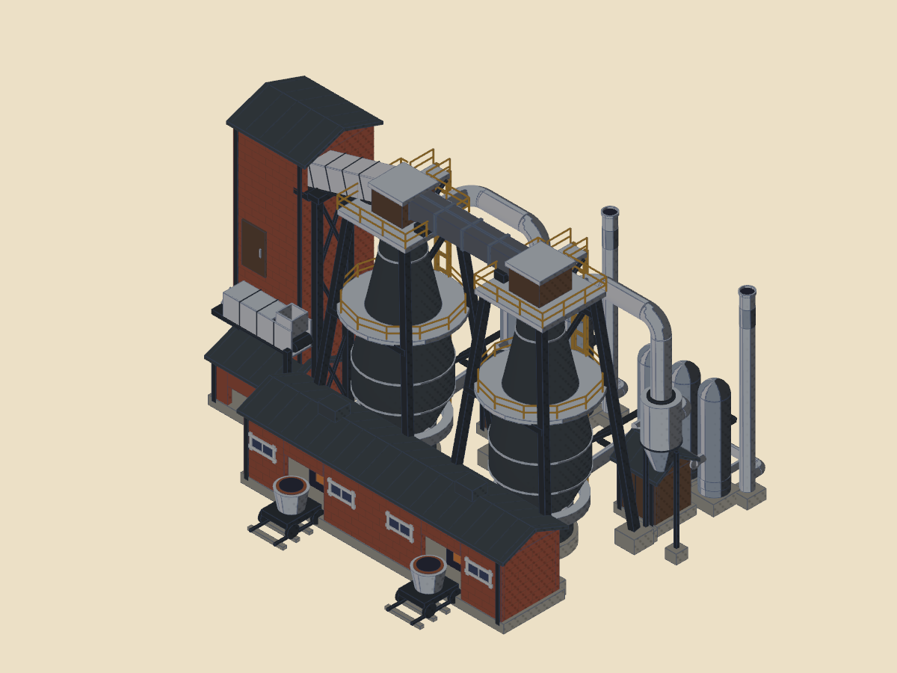
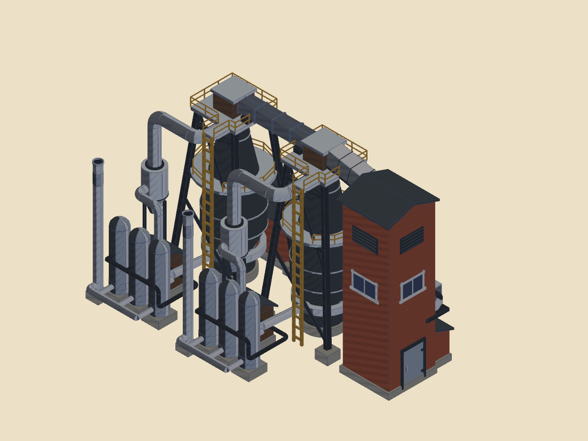
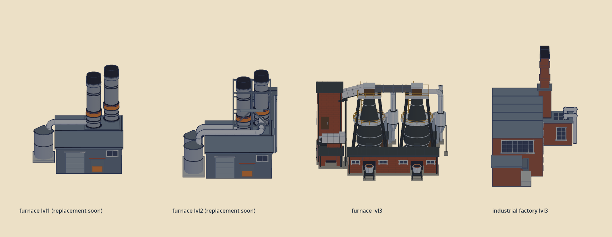

# Furnace L3 — 16 October 2026

The new twin-furnace L3 is installed in the 2D sprite view and rotatable 3D supply-chain view. **New L1 and L2 artwork is coming soon.** Their existing sprites, models, masks and anchors remain in use.

## Proportion review

Retained the reviewed compact layout: matching furnace frames, shared casting hall, two-stage charging route, brick handling tower, dark iron vessels and polished steel stoves. The hopper cone is silver steel against the brown cleaning enclosure. The tower has rear maintenance windows, louvres and door hardware. Brick coursing is restrained and survives vertex-colour export.

At a common 100-unit placement scale, L3 is 100 × 78.80 in plan and 64.10 high. Existing L2 is 71.38 × 67.59 and 69.59 high; the existing L3 factory is 64.72 × 100 and 75.78 high. L3 reads as a wider twin works with similar overall height, rather than a taller single stack. No additional stretching or enlargement was applied. Review uses the actual runtime mesh/material loader; the final 2D sprite remains 800 × 800.

## Integration and bakes

Replaced only `furnace_lvl3`: sprite, GLB, 2D window/heat masks, smoke/heat anchors, far and medium colour/depth atlases, medium lit atlas and picking resource. Each atlas contains 16 azimuths × 5 pitches; far cells are 64px and medium cells 128px. Atlas and picking provenance matches the installed model SHA-256.

The packaged starting snapshot contains 50 furnaces, all L1. Its terrain, layout and scenery resources therefore remain valid. The unchanged production package passes independent validation: 600 tiles, 1,841 resources, 1,307,187,841 bytes, current fingerprints and no errors. No unrelated map resources were regenerated.

A fresh Godot 4.6.2 Forward+/Metal process on Apple M5 Pro, warm filesystem and an empty runtime-cache path measured:

| Check | Result |
| --- | ---: |
| Process to Begin | 19.400 s |
| Owned supply view opening | 375 ms |
| First fully revealed continent tile, including transition | 2.862 s |
| Requested working set after pan | 4.600 s |
| Bundled hits / misses / writes | 103 / 0 / 0 |
| Successful tile picks | 14 |
| Frame p95 / first-use maximum | 30.744 / 270.860 ms |

The runtime cache directory was not created. These are single-run warm-filesystem measurements, not cold-disk guarantees. The existing first-use frame hitch remains.

76 geometry checks pass. L1/L2 assets are byte-identical to the base branch. The heat mask has 252 active pixels and the window mask 1,140; both stay inside the sprite. Mask rendering now resets polygon material indices after replacing reflection materials, and packaging removes near-black render dithering. A coverage guard prevents broad building surfaces from becoming glow masks.

## Reproduction and pending work

`tools/building_assets/furnace_builder.py` is the editable source. `furnace_paper.py` and `paper_wpa_catalog.py` implement the approved print pass. The building pipeline can stage all draft levels, but only L3 is released. Ordinary `export_models.py -- furnace` exports L3 only, preserving installed L1/L2; `POE_FURNACE_VARIANT=paper-wpa` explicitly enables all three drafts for review. The staging installer also filters out pending furnace L1/L2. Installing sprites/models still requires the matching masks, anchors and derived atlas/picking bakes described above.

Render verification: `AGENT_GODOT_WINDOW=1 godot --path . res://tools/supply_chain_3d/review_furnace_l3.tscn -- --no-telemetry`. The audit scene `audit_furnace_package.tscn` reports furnace levels used by the packaged snapshot. Far/medium bake tools support `--asset-keys=furnace_lvl3` to avoid rebuilding other assets.
