# Furnace V2, generic shaft-furnace works — 16 and 17 October 2026

**Installed** on 17 October 2026 as the game's furnace, all three levels, on top of the catalogue-look 3D renderer. Revision: `outputs/furnace-v2-2026-10-16/v30-final`.

## Installation

**Catalogue styling.** The furnace uses the industrial factory's material vocabulary, so the 3D print shader draws it the same way: brick coursing on its brick, standing seams on pitched roofs (`f_roof`, the factory's roof-metal colour), gravel on flat roofs (`membrane`), panel joints on the refractory cladding, paving on footing tops, stone lintels, sills, cornices and chimney bands, warm white process pipework, silver rainwater goods, and the factory's see-through teal glass over a dark interior panel. The GLBs carry the outer ink contour like the factory. `export_models.py` maps the furnace's material names to the shader's pattern codes.

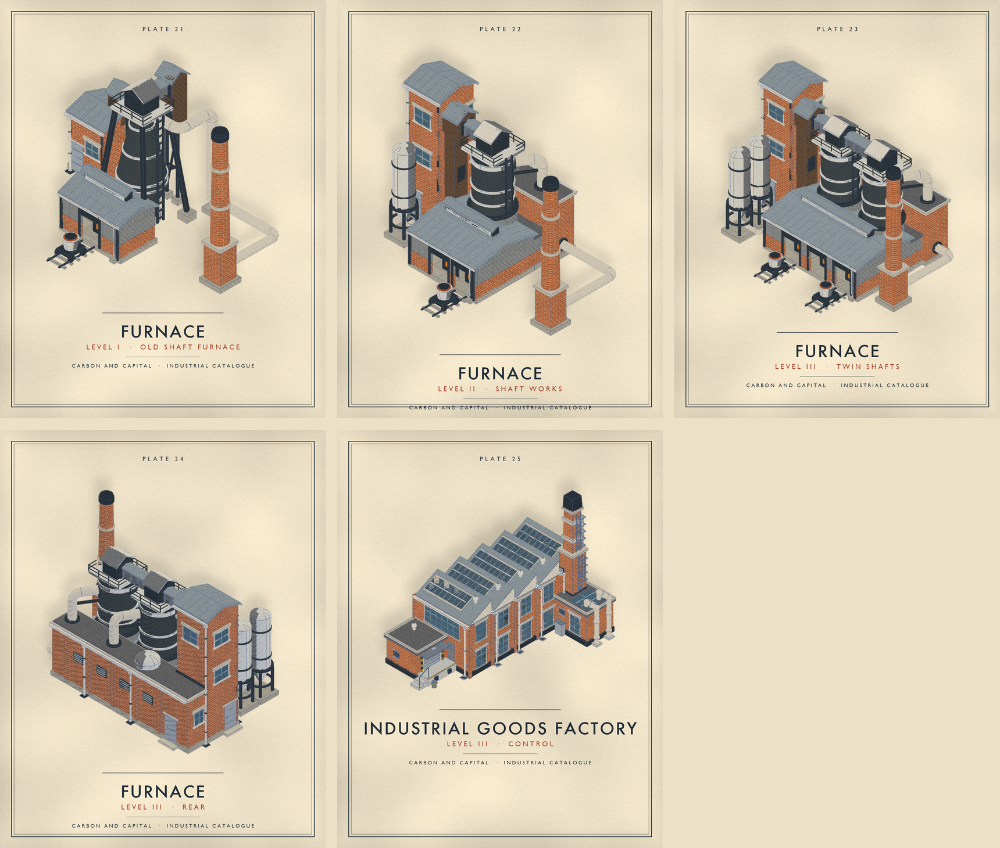

**What was installed.**

| Layer | Files |
| --- | --- |
| 2D sprites | `assets/icons/buildings/sprites/furnace_lvl{1,2,3}.png`; provenance in `detailed_buildings_manifest.json` (`staged_as: furnace_v2`) |
| 2D effects | `assets/fx/windows/` and `assets/fx/light/furnace_lvl{1,2,3}.png`; smoke and glow anchors in `scripts/empire_fx.gd` |
| 3D models | `assets/supply_chain_3d/furnace_lvl{1,2,3}.glb` and `_contour.glb`; entries in its `manifest.json` |
| 3D impostors | far and medium colour/depth atlases, medium lit atlases and their manifests |
| 3D picking | `assets/supply_chain_3d/picking/furnace_lvl{1,2,3}.res` |

**Reproduce.** From the game project:

```sh
python3 tools/building_assets/pipeline.py build --revision <rev> --families furnace_v2 --output <dir>
blender --background --factory-startup --python tools/building_assets/furnace_v2_fx.py -- <dir>/<rev>
python3 tools/building_assets/package_furnace_v2_fx.py <dir>/<rev>
python3 tools/building_assets/pipeline.py models --revision <rev> --output <dir>
python3 tools/building_assets/pipeline.py install --revision <rev> --output <dir>
godot --headless --editor --import --quit --path .
AGENT_GODOT_WINDOW=1 godot --path . res://tools/supply_chain_3d/bake_far_sprites.tscn -- --asset-keys=furnace_lvl1,furnace_lvl2,furnace_lvl3 --no-telemetry
AGENT_GODOT_WINDOW=1 godot --path . res://tools/supply_chain_3d/bake_far_sprites.tscn -- --medium --asset-keys=furnace_lvl1,furnace_lvl2,furnace_lvl3 --no-telemetry
AGENT_GODOT_WINDOW=1 godot --path . res://tools/supply_chain_3d/bake_medium_lighting.tscn -- --asset-keys=furnace_lvl1,furnace_lvl2,furnace_lvl3 --no-telemetry
godot --headless --editor --import --quit --path .
```

The anchors written by `package_furnace_v2_fx.py` (`fx/anchors.json`) go into `ANCHORS["furnace"]` in `scripts/empire_fx.gd`. A `furnace_v2` revision installs under the game name `furnace` (`GAME_NAME` in `pipeline.py`).

**Verification.**

- The far and medium atlas provenance of all three levels matches the installed GLBs' SHA-256, and the lighting bake stamps the picking resources the same way.
- **The map package had to be rebaked.** `world_builder.gd` puts each standing building's model dimensions into the package's scenery key and each far sprite's span into its continent key, so the new furnace models made all 600 tiles stale: a fresh process measured 377 s to Begin with 604 misses and 605 runtime writes. `verify_continent_package.tscn` passed throughout, because it checks the package only against itself. The production rebake (`bake_continent_package.tscn -- --continent-review --prune`) took 21 minutes; the new package validates with 600 tiles, 1,806 resources and no errors. On this branch the package holds terrain, roads and scenery only; buildings are placed at run time, so every furnace the world creates draws the new model.
- **Fresh process, empty runtime cache** (`profile_startup.tscn -- --continent-review --combined-open --all-tiles-on-start`, disposable home directory so `user://` starts empty), Apple M5 Pro:

| Check | Stale package | Rebaked package |
| --- | ---: | ---: |
| Begin offered | 377.0 s | 19.5 s |
| Continent load misses / runtime writes | 604 / 605 | 0 / 0 |
| Bundled hits after streaming | 1 | 97 |
| Combined opening ready | 52.0 s | 2.3 s |
| Main map frame p95 / max after Begin | 7.5 / 58.6 ms | 19.1 / 26.1 ms |

  Single warm-filesystem runs, not cold-disk guarantees.
- Parse check: 889 scripts, 0 failed.
- Unit suite: 6,725 passed, 12 failed (and the supply-chain group alone, after the rebake: 1,590 passed, the same 10 of those 12). The pristine catalogue-look branch fails the same 12, plus one window-size flake. They concern road roll-out, Stoneshore endpoints, river climbs, the building catalogue count, a pending save, and far/medium bakes that are stale or missing for farms, water pumps, forests, desalination, oil wells and crop cells. All furnace bakes are current.

**3D depth faults fixed while installing.** The 3D view showed brick flickering through the hall cladding. Trial exports isolated the cause: a plinth or column buried inside a hollow wall slab shows through it in the 3D view, which the Blender sprite never does. The outline shell was ruled out. The hall's and back aisle's walls are now a brick base course stacked under the cladding in one plane, the portal and bay columns stand on the wall face, the bridge covers stop short of their flanges, door leaves stand clear of their walls, and the regenerator wing always runs past the hall's end wall.

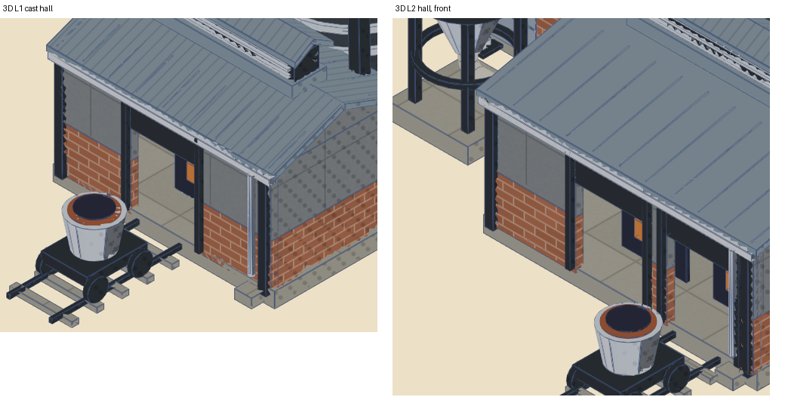

**Rainwater.** The regenerator wing has a continuous gutter along its back edge feeding its downpipes. The tower's back downpipe runs past the wing's end wall to its own drain.

## Why

The furnace building serves 21 recipes across twelve outputs (steel, iron, copper, aluminium, alumina, alloy, glass, graphite, carbonised biomass, lithium carbonate, concrete), and steel already has its own Electric Arc Furnace. The installed L3 is an ironworks: bosh taper, raking columns, Cowper stoves. V2 keeps the shared furnace vocabulary (stockhouse, charging route, hot hall with glowing bays, gas cleaning, stack, ladles) and replaces the iron-only core with straight-sided dark-metal shaft furnaces, a regenerator and a monitor-roofed hall, which is what a glass tank, a lime or copper shaft furnace and a graphitising hall have in common.

L1 is deliberately different: a simplified version of the old blast furnace, the tapered dark-metal vessel on four raking columns with a crown deck and charging lock, an incline from a low brick stockhouse, a one-bay cast hall in the family cladding, and the same chimney as the higher levels. The step from L1 to L2 is therefore the big one: from a single old-style furnace to a shaft works with its hall, tower, silo and regenerator.

Brick (owner's seventh and eighth reviews): the brick matches the catalogue factory's in colour and joint. The factory's coursing is a 3D-view shader pattern (`building_paint.gdshaderinc`): 0.075 courses, 0.21 bricks in stretcher bond, joints 0.010 wide, joint colour 60% lime (0.74, 0.70, 0.62) over the brick, ±5% brick to brick. The sprite rebuilds it as a Blender brick texture in world space, course direction chosen by the face normal and blended round the chimney, top faces plain.

The first match (v13) read lighter for two measured reasons. Blender applies Mortar Size on each side of a joint, so 0.009 gave 0.018-wide joints, 1.8 times the shader's, softened further by Mortar Smooth. And the factory plate is lit by Godot while the sprite is lit by Blender and the face mask, so the factory's base value printed lighter and more orange. Mortar Size is now the half width 0.005 with no smoothing, and the sprite's brick texture takes a per-channel linear ratio tuned on the printed result. The material's own base colour keeps the factory value, which is what the GLB export reads, and its name keeps `brick` so the 3D view's own pattern applies.

| Printed sprite, lit face | Brick body (RGB) | Joint (RGB) |
| --- | --- | --- |
| Catalogue factory | 141–144, 86–88, 62–63 | 155–157, 115–116, 91–92 |
| Furnace v13, factory base value | 164, 111, 79 | 171, 149, 132 |
| Furnace v16 and v17, matched | 144, 89–90, 64–65 | 153–154, 119, 97–98 |

Zoomed in, the furnace joints still blur over about two pixels where the plate's are one: the sprite draws a course in about 6 pixels against the plate's 8, so a joint of the same true width falls between pixels. At sprite size the two walls read as the same brick.

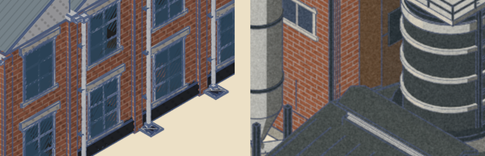
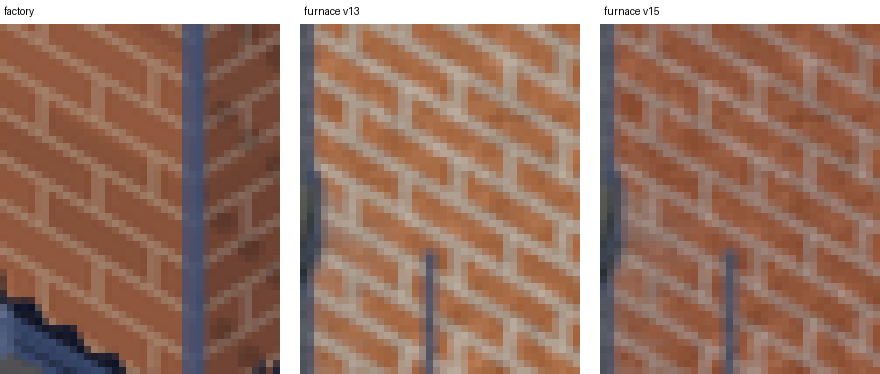

## Rear view and back range

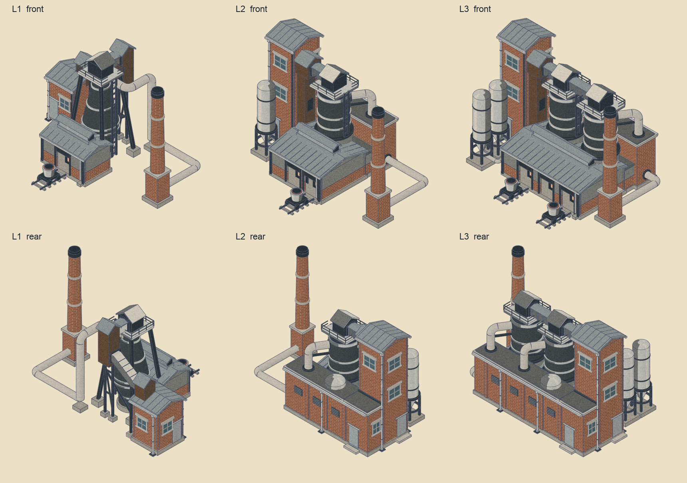

Rendered from the opposite azimuth with the same method as the installed furnace L3's reverse review, then printed like the front sprites.

Tenth review: lift junctions and rear detail.

- Every lift junction is a gable. Each furnace top carries a small gabled charging house in place of the bare charging box, in the box's old dark iron with a zinc roof (twelfth review; the lift's other housings are brown sheet), ridge along the incoming conveyor, and the conveyor enters its gable wall on a flange. At L2 and L3 the elevator head on the tower is the same house, centred on the bridge, and the tower is raised so the house sits under its eaves and its roof butts the tower wall instead of running into the tower roof. The bridges run gable to gable under a shallow ridged cover that meets each gable at the same pitch.
- L1's lift (revised in the eleventh review): a straight inclined box meeting vertical walls at a skew showed as a pointed wedge at the head house, and from the rear the incline seemed to sink into the stockhouse roof. The gallery is now one bent mesh with mitred knuckles: it leaves a small gabled tail house standing on the stockhouse roof, level and square through its gable, bends up on a trestle, climbs at about 32°, bends level again and enters the head house's gable square-on. The bends ink as fold lines, and from every side the gallery comes out of a wall rather than a roof slope. It runs 0.23 further back than before, so the front view no longer shows a fragment of it between a column and the vessel. A short covered stub runs from the head house into the charging house's gable over the deck.
- Rear detail, in the catalogue factory's vocabulary: windows with cream frames, glazing bars, stone sills and lintels on the tower's rear and back faces, on L1's stockhouse and on the wing's end wall; eaves gutters on the tower and stockhouse; downpipes with hopper heads, brackets, shoes and drain grates; brick pilasters, scuppers and downpipes along the regenerator wing; rear doors on stone steps.
- Silo feeds now run square to the buildings into the elevator boot, the second silo teeing into the first.

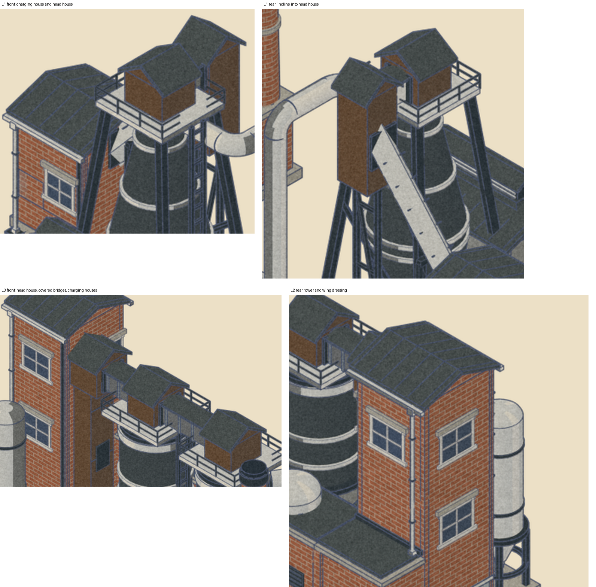
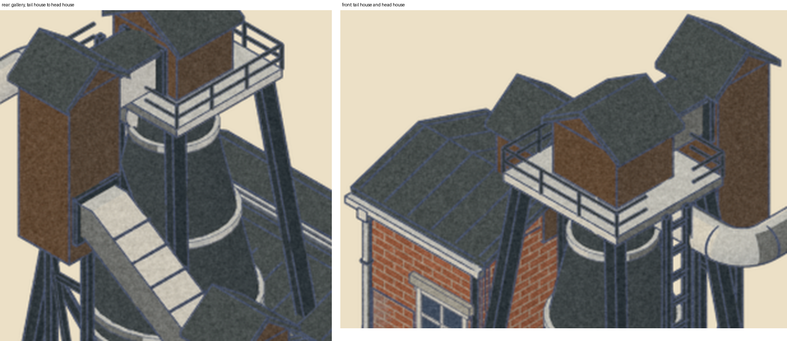

Ninth review, from the rear. The squat domed block was the regenerator, not a downcomer. At L2 and L3 it is now a long low brick wing behind the hall that runs out from the lift tower, so tower and regenerator read as one L-shaped range. A flat-roofed refractory back aisle closes the hall up to the wing, which encloses the drum backs that previously stood 0.32 outside the hall's back wall. Each downcomer leaves its drum just under the crown through a flange, runs back over the aisle and drops on to the wing roof through a collar, so the gas route is visible from front and rear. The waste flue leaves the wing's far end into the chimney base.

Interpenetrations removed in the same pass:

- L1: the incline used to rise through the crown deck into the lock. It now ends in a head house beside the crown, and a short level stub at the lift top runs over the deck, through a gap in the left rail, into the lock face on a flange.
- L2 and L3: the downcomer used to leave from inside the crown deck. It now leaves the shell below the head ring, with the hoops stopped short of it.
- Bridges end at lock faces on flanges instead of running through the locks. Shaft ladders stand on the housing cap instead of passing through it, and reach the deck through a gap in the right rail.
- The monitor roof is narrower and the drums sit a little further back, so the housings clear it.
- Silos: the legs used to stand outside the body and touch nothing. They now carry a support ring under the body, with a tie ring lower down.

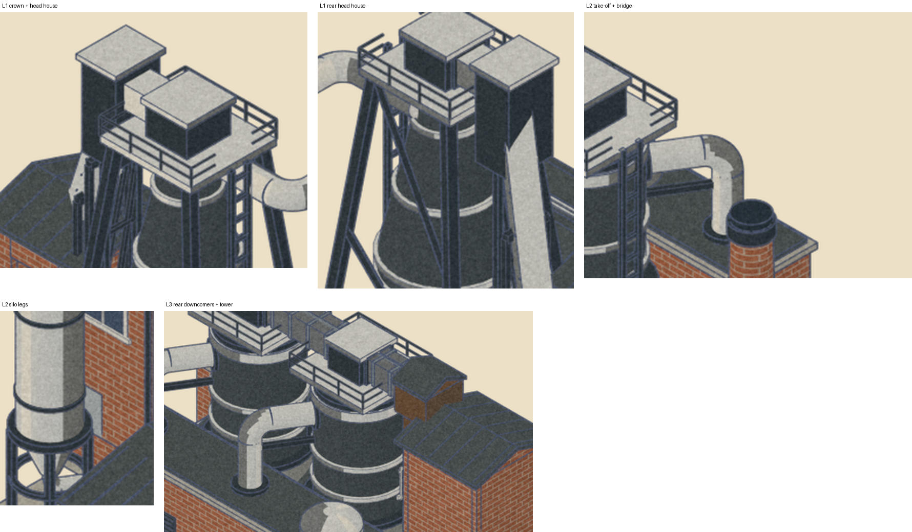

Visible shell (owner's sixth review): the L2 and L3 hall is now the height of L1's cast hall, the refractory housing is a short collar at the roof line rather than a tall sleeve, the monitor roof is lower and narrower, and the drums sit in the back half of the hall clear of it. The dark cylinder therefore shows from the roof line to the crown over the same height as L1's chamber shows above its cast hall. The low duct line moved back to clear the drums.

Furnace height (owner's fifth review): every furnace at every level carries the same crown, a railed zinc deck on the vessel top with the charging lock on it, and the lock centre is the lift top. So the L1 vessel, the L2 drum and both L3 drums top out at the same height, and the charging bridge arrives at the lock exactly as L1's incline does. The old cone head, charge box and ladder landing on the drums are gone.

Roof junction (owner's fourth review): the L2 and L3 shafts stand at the same height as L1's vessel. Where each shaft rises through the hall roof it is wrapped in a refractory housing, a ceramic collar that starts inside the roof and rises a little above it to a dark steel cap ring, so the meeting of drum and roof is a built joint with its own outline rather than an unmarked interpenetration. The downcomer's lower bracket ties to the housing, the upper one to the shell.

Gas route (owner's third review, revised in the ninth): the dust filter box is gone. At L1 the downcomer leaves the throat, drops to the ground and a low flue runs round the back into the chimney base. At L2 and L3 the downcomers land on the regenerator wing's roof and the waste gas leaves the wing's far end into the chimney base, which is the honest route for a regenerative furnace. Flues enter the chimney at its base through a breeching, as brick chimneys do.

Standardised across levels after the owner's second review: the furnace vessels are dark metal with silver hoops; every duct is silver zinc; the thin black-topped brick chimney stands in the same place at every level; L1's stockhouse stands where L2's tower stands; and L1's incline and L2's charging bridge both end at the same lift-top height.

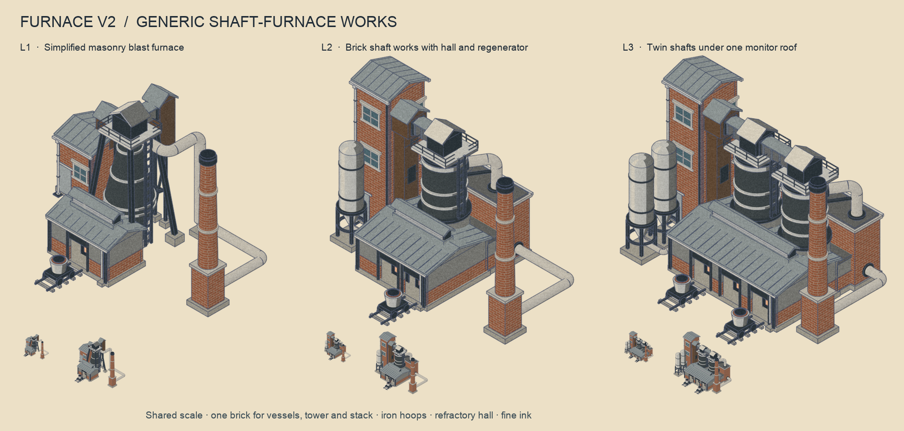
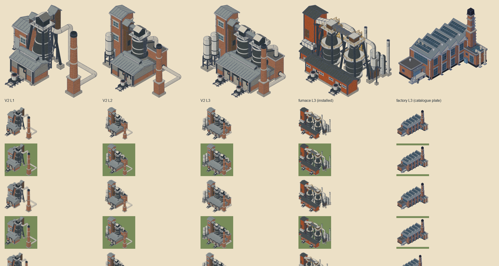
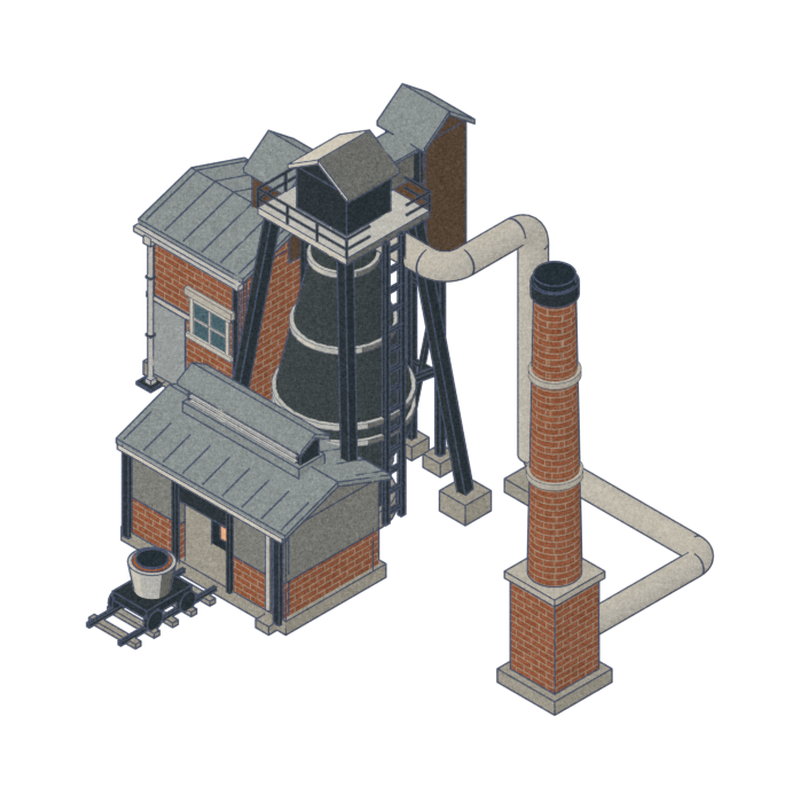
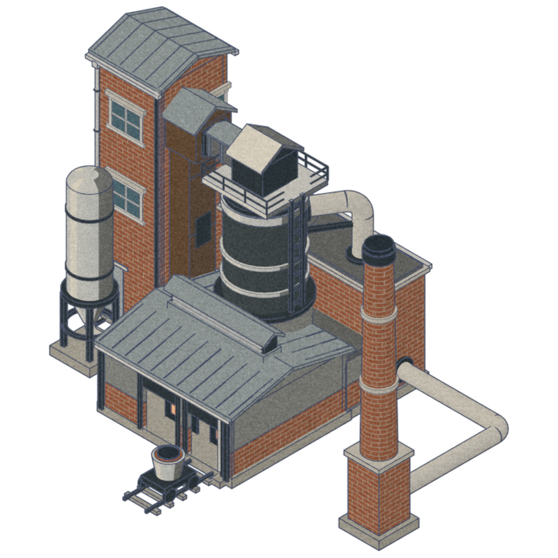
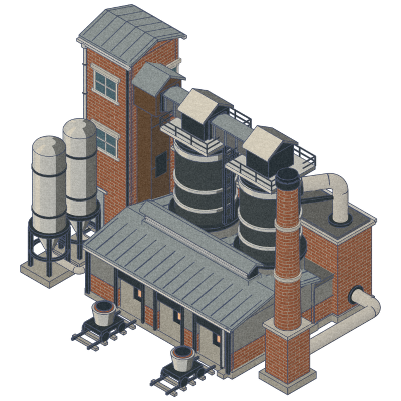

## Measurements

| | V2 L1 | V2 L2 | V2 L3 | Installed L3 |
| --- | ---: | ---: | ---: | ---: |
| Edge pixels per opaque pixel at 70 px | 0.30 | 0.31 | 0.33 | 0.36 |
| Tone spread at 70 px | 34 | 33 | 33 | 41 |
| Triangles (game mesh) | 8,256 | 12,116 | 19,486 | 44,124 |

Geometry validation passed on all three levels (nothing below ground, no bbox warnings). Mask range and sprite bounds pass the pipeline's metrics; the sprites verify against the frozen source.

## Review notes

- Materials: dark metal vessels, silver zinc downcomers, flues, hoops and silos, the factory's brick and joint on tower, regenerator and chimney, refractory grey halls. No yellow, no polished steel. The silver ducts raise the 70 px edge density back towards the installed L3; that is the owner's choice, and medium grey is the fallback if they sparkle on the map.
- The chimney is thin, brick, tapered and black-topped, fixed at the front right and the tallest element at every level.
- Level progression: L1 is the old-style single furnace; L2 is the shaft works; L3 doubles the shafts and lengthens the hall. The furnace crown is identical at every level, so the furnaces read at one height.
- L3's edge density now sits above the installed furnace at 70 px because two railed decks sit side by side under the bridge; the rails are at the fine-ink tier and drop out below 128 px.
- Open: at L2 the chimney's top overlaps the downcomer's foot on screen from the home camera; they are a metre apart in depth but read as touching at 70 px. The hall's monitor louvres are at the fine-ink tier and vanish below 128 px, which is intended.

## Pipeline changes

`tools/building_assets/pipeline.py` knows a second paper family (`PAPER_FAMILIES`), freezes and executes `furnace_v2_builder.py` after `furnace_builder.py`, proofs each paper family, and refuses to install `furnace_v2`. `furnace_paper.py` takes a `family` argument. `tools/supply_chain_3d/export_models.py` has a `furnace_v2` spec with a `prelude` list so a builder can extend another family's palette and helpers.

The image reference step (`outputs/furnace-alternatives-2026-10-16/brief-furnace-v2.md`, Project Rebirth's `asset-image`) failed with HTTP 401 on the exported key; the works was built from the written brief.
