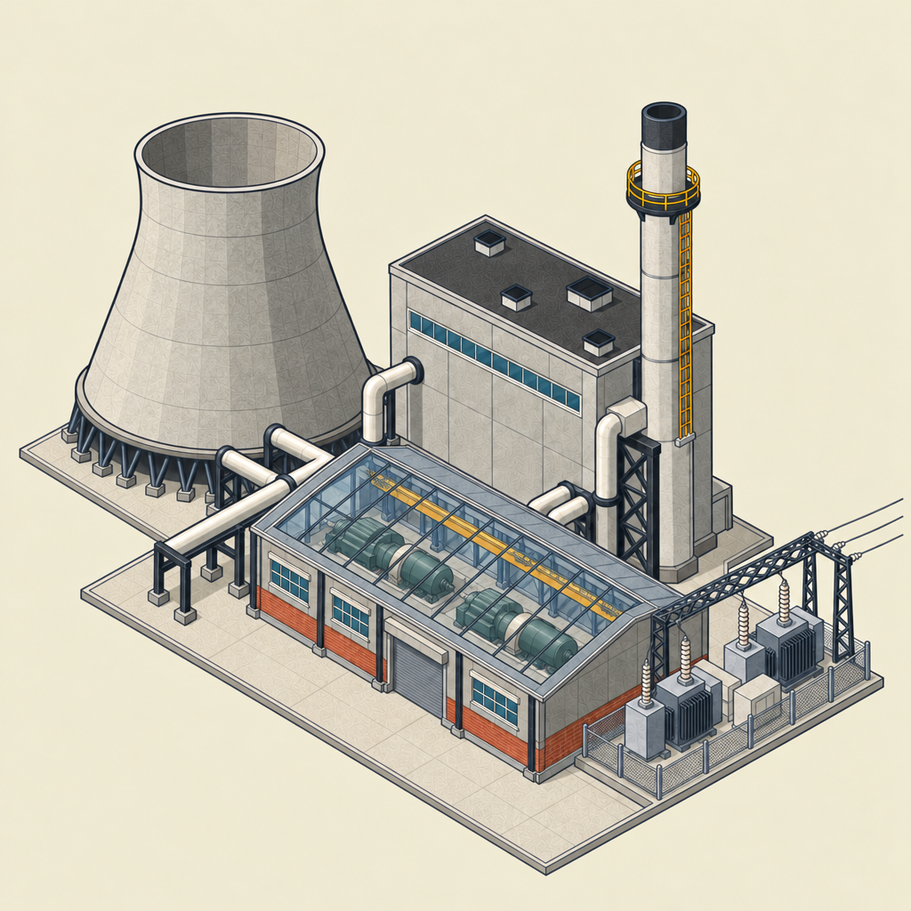
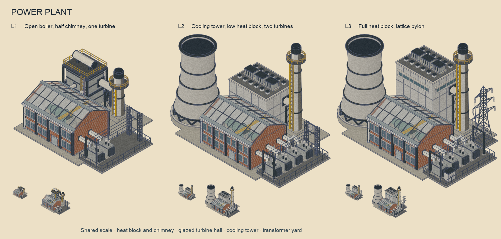
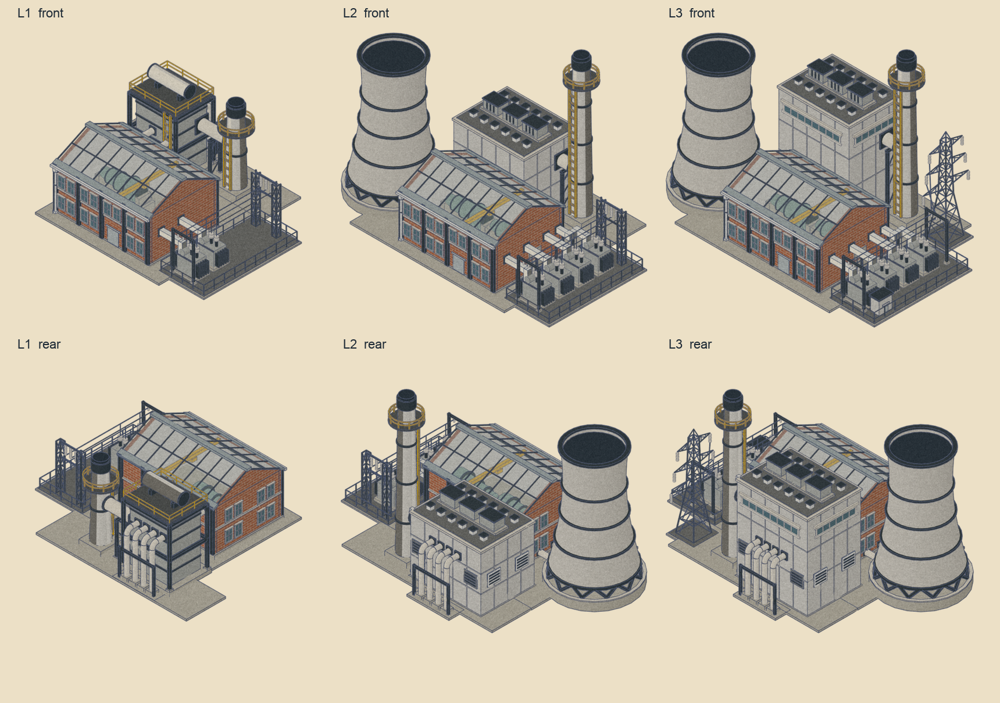
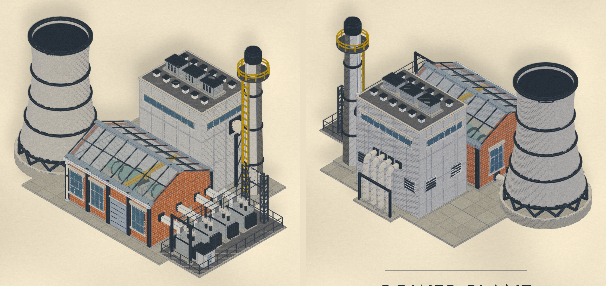
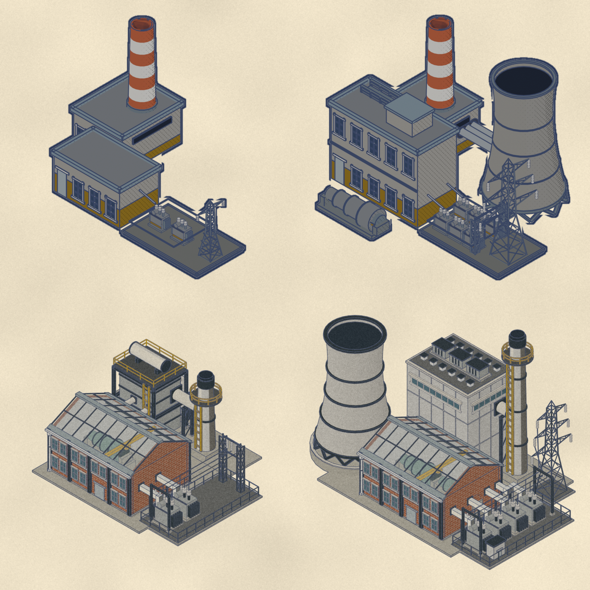

# Power plant, rebuilt in the catalogue look — 17 October 2026

**Installed** on 17 October 2026 as the game's power plant, all three levels, together with the rebuilt refineries
(`docs/reviews/refinery-v2-2026-10-17.md`). Revision:
`outputs/power-plant-v2-2026-10-17/v20-slim-lintels`. Source:
`tools/building_assets/power_plant_v2_builder.py`, which runs after `furnace_builder.py`,
`furnace_v2_builder.py` and `refinery_v2_builder.py` and shares their helpers. Family
`power_plant_v2` installs as `power_plant`.

A fuel-neutral thermal station: it reads as a power station whether it burns coal or runs
gas turbines. The composition came from an image reference the owner chose (B3, revised to
B4: turbines on show through a glass roof, a cooling tower twice the size), then through
nine owner reviews of the Blender build.



## The plant

| Part | What it is |
| --- | --- |
| Turbine hall | Brick, glass and black pillars only: brick walls with the factory's coursing, two floors of small factory windows in pairs with a stone floor band, a ground-floor roller door, and a shallow glazed roof over two turbine-generator sets on a raised deck and a yellow crane. A pale lining inside keeps the far walls from turning the glass red. |
| Heat plant | L1: an open boiler (casing with stiffener bands and burner ports in a steel frame, railed deck, steam drum). L2: a shorter clad block with no windows. L3: the full block with strip windows on all four faces. Roof: small vents, electrical cabinets, small vents, symmetrical. Back and left faces: panel joints, louvres, and four service pipes into the ground. |
| Chimney | Slim stack with a black-grey deck, yellow barrier and ladder. Half height at L1. Fed by a flue duct from the heat plant's side. |
| Cooling tower | L2 and L3, the same tower: a true hyperboloid on raking legs over a basin, faceted bands proud of the 3D outline shell. Two cooling-water lines into the hall's end wall. |
| Transformer yard | In the corridor beside the hall: two transformers at L1, four from L2, bus ducts from the hall end (the rearmost with elbows), an overhead three-phase line from a light front frame with vertical droppers. L1 and L2 take off over a gantry at the back; L3 over a tall lattice pylon in the back right corner, square to the grid. L3 adds a switch kiosk. |

Flows, all closed: fuel and service lines into the heat plant; flue gas to the chimney; steam
into the hall; cooling water between the hall and the tower basin; power from the hall end
along the bus ducts to the transformers, up to the line and out over the gantry or pylon.






## Measurements

| | L1 | L2 | L3 | Old L3 |
| --- | ---: | ---: | ---: | ---: |
| Triangles | 13,036 | 18,864 | 20,876 | 15,288 |
| Edge density at 70 px | 0.36 | 0.38 | 0.38 | 0.24 |

L3 fills the shared sprite scale's width exactly; the pylon's arm length is what sets it.

## Lessons that apply to other buildings

- **Glass hides ink.** Freestyle treats a glass pane as opaque, so anything under a glazed
  roof prints as faint colour with no lines. The hall's contents are linked into a
  `PP_INTERIOR` collection with their own `ink_interior` line set that draws through one
  surface; each roof pane is a single quad and every wall is a box, so the plant is inked
  through glass and never through a wall. The kit's `render_sprite.py` now keeps any
  `ink_*` line set a builder adds (it used to drop every set but `ink` and `ink_fine`).
- **Sightlines under glass.** On the floor by the front wall the eave hides the turbines;
  they stand on a raised deck behind the hall's centre.
- **The 3D outline shell pierces thin bands.** `export_models.py` inflates each part by about
  4.5 cm (4 px at ortho 11.6 over 1024 px), so a band or rim proud by less than that is cut
  through by its host's shell and reads ragged. Bands must sit on the host's own facets and
  stand at least 5.5 cm proud.
- **Small windows need small frames.** The kit window's frame members are fixed widths (5 cm
  frame, 2.6 cm bars, a deep sill) that swamp a half-size window. `_pp_window` and
  `_pp_door` scale every member with the opening.
- **Square pads waste width.** Paving that runs to the far back corner set the sprite's width
  before the plant did; the paving follows the buildings as an L.

## Installation

| Layer | Files |
| --- | --- |
| 2D sprites | `assets/icons/buildings/sprites/power_plant_lvl{1,2,3}.png` |
| 2D effects | `assets/fx/windows/power_plant_lvl{1,2,3}.png`; chimney smoke, tower steam and the traced line in `ANCHORS["power_plant"]` (`scripts/empire_fx.gd`) |
| 3D models | `assets/supply_chain_3d/power_plant_lvl{1,2,3}.glb` and `_contour.glb` |
| 3D impostors and picking | far, medium and lit atlases with `--asset-keys` |

**Reproduce.** From the game project:

```sh
python3 tools/building_assets/pipeline.py build --revision <rev> --families power_plant_v2 --output <dir>
blender --background --factory-startup --python tools/building_assets/building_fx.py -- <dir>/<rev> power_plant_v2
python3 tools/building_assets/package_building_fx.py <dir>/<rev> power_plant_v2
python3 tools/building_assets/pipeline.py models --revision <rev> --output <dir>
python3 tools/building_assets/pipeline.py install --revision <rev> --output <dir>
```

then the far, medium and lit bakes with `--asset-keys=power_plant_lvl1,power_plant_lvl2,power_plant_lvl3`,
an import, the map-package rebake and a fresh-process startup check, as for the furnace
(`docs/reviews/furnace-v2-2026-10-16.md`). `fx/anchors_power_plant.json` goes into
`ANCHORS["power_plant"]`.

**Verification** (all three buildings, installed together):

- The far and medium atlas provenance of every level of all three buildings matches the
  installed GLBs' SHA-256.
- Map package: rebaked with `bake_continent_package.tscn -- --continent-review --prune`. It
  reused all 600 tiles (unlike the furnace, these models left the package keys unchanged);
  validation clean, 600 tiles, 1,806 resources.
- Fresh process, empty runtime cache (`profile_startup.tscn -- --continent-review
  --combined-open --all-tiles-on-start`, disposable home directory), Apple M5 Pro: Begin
  offered at **20.3 s**; continent load 0 misses and 0 runtime writes; 101 bundled hits after
  streaming; combined opening ready in 2.5 s. A single warm-filesystem run.
- Parse check: 889 scripts, 0 failed.
- Unit suite: 6,725 passed, 12 failed, the same 12 as the pristine
  catalogue-look branch (road roll-out, Stoneshore endpoints, river climbs, the
  building catalogue count, a pending save, and far/medium bakes stale for farms, water
  pumps, forests, desalination, oil wells and crop cells). None names the refineries or the
  power plant. The two GDScript runtime errors in `road_placement.gd` also appear on the
  pristine branch.
