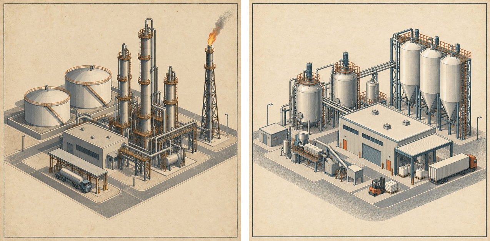
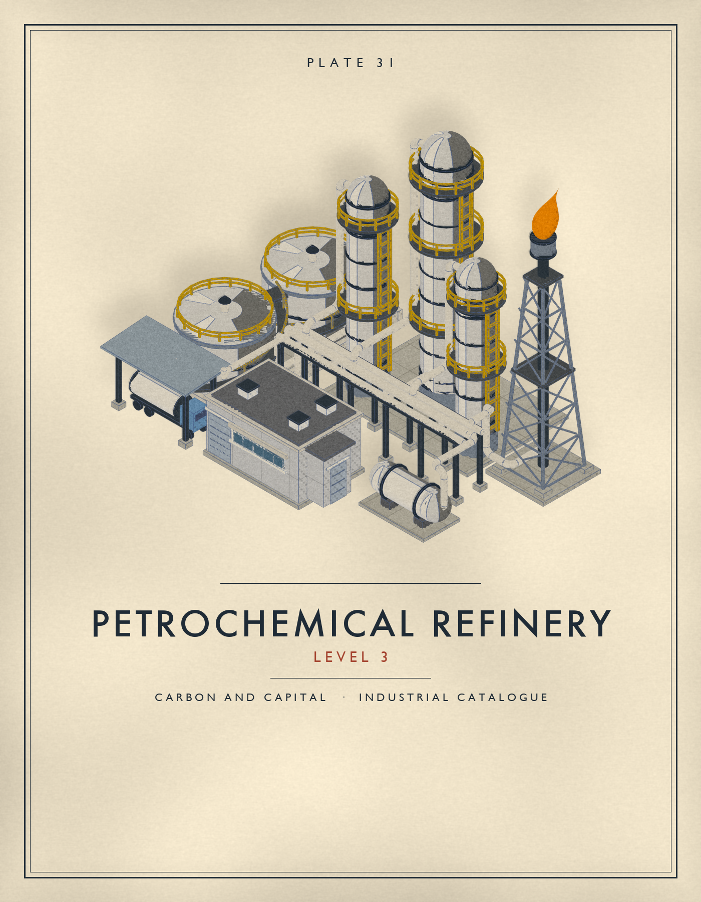
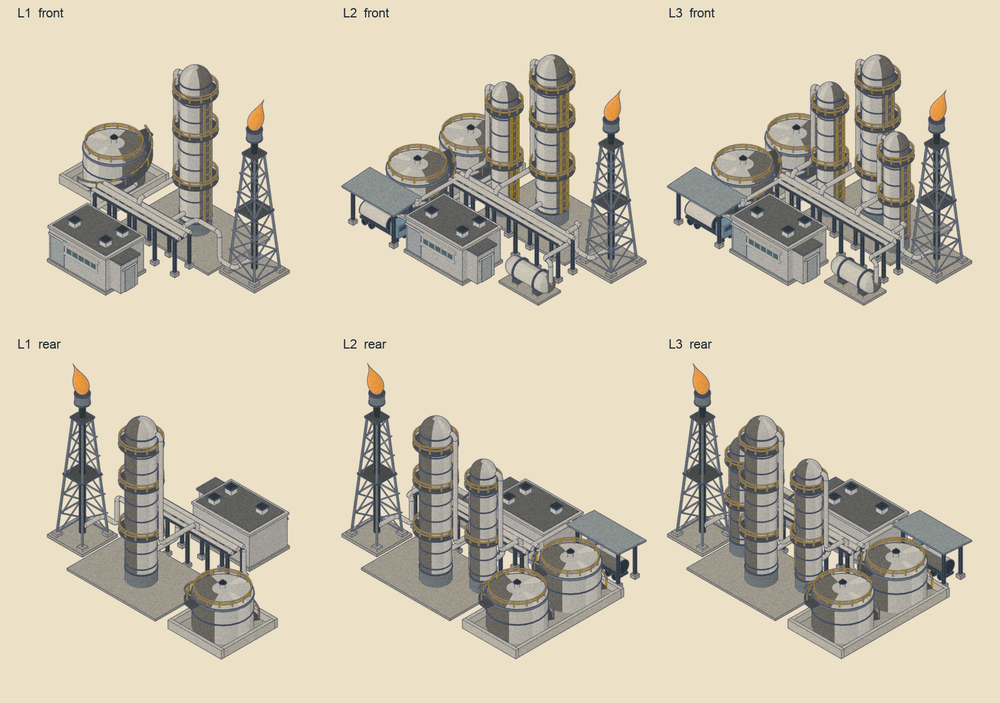
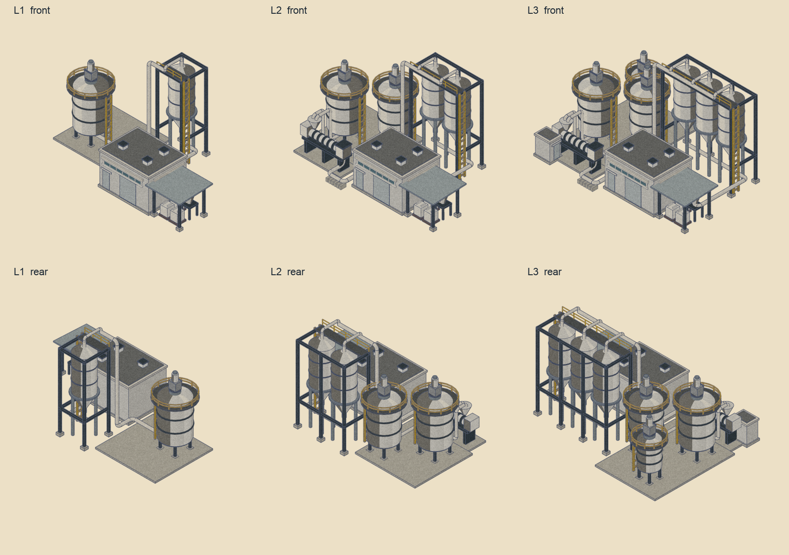
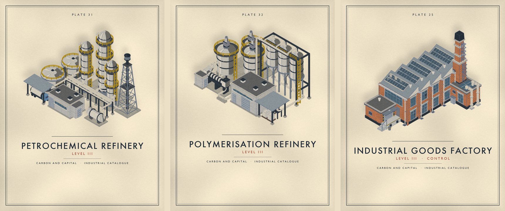
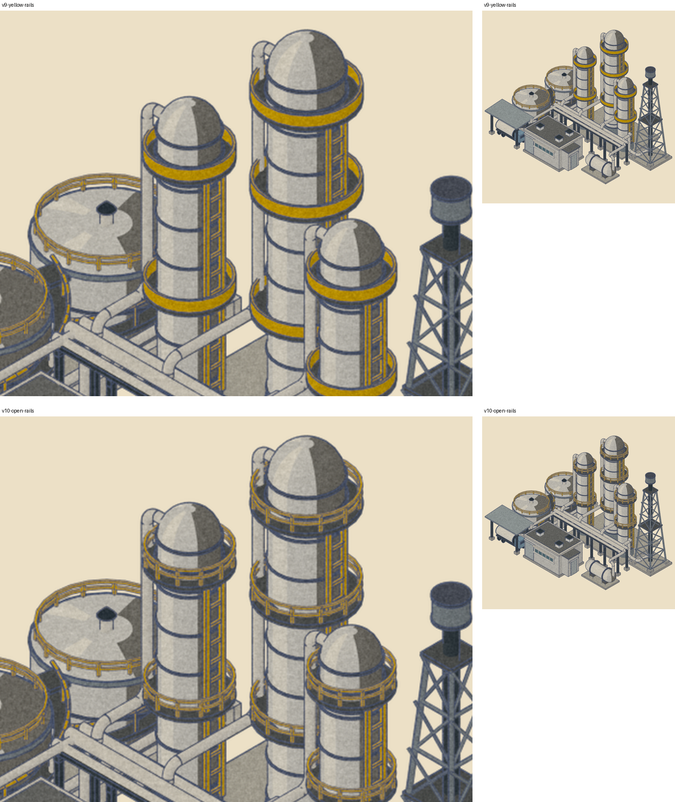

# Petrochemical and polymerisation refineries, rebuilt from references — 17 October 2026

**Installed** on 17 October 2026 as the game's petrochemical and polymerisation refineries, all three levels, at revision `v12-flame`, together with the rebuilt power plant (`docs/reviews/power-plant-v2-2026-10-17.md`), which records the shared install and verification. Built from the owner's two reference illustrations in the catalogue
look. Revision: `outputs/refinery-v2-2026-10-17/v12-flame`. Source:
`tools/building_assets/refinery_v2_builder.py`, which runs after `furnace_builder.py` and
`furnace_v2_builder.py` and shares their helpers. Families `petro_refinery_v2` and
`poly_plant_v2` install as `petro_refinery` and `poly_plant`.

## Petrochemical refinery

Tanks with roof rails and wrap-round stairs in a bund at the left; distillation columns with
black-grey platforms, yellow barriers and caged ladders at the back; a pipe rack carrying their lines forward; a
render-clad control building with a strip window at the front; a flare on a lattice tower at
the right; a tanker loading canopy with a parked road tanker at the front left.

| Level | Adds |
| --- | --- |
| L1 | One tank, the tall column, short rack, control building, flare |
| L2 | Second tank, second column, exchanger, loading canopy and tanker |
| L3 | Third column, in front of the tall one |

Flows, all closed: each tank has its own line and riser into the rack; each column's
overhead and bottoms lines run to the rack; the rack feeds the exchanger and the loading
arm; a relief line runs from the rack to the flare.

The flare burns. The flame is one droplet mesh tucked into the burner shield, leaning
screen-right with the 2D view's wind, so it shows in the sprite and in the 3D model, which
has no animated flame. It has its own emissive, `r_flame` (0.95, 0.32, 0.02 at strength 1),
because the kit's ember is light enough that the print sends it toward paper and drains it
to peach. At install, the 2D view's petro anchors must not add an animated lick on top: give
the flare tip a glow only (`lick: 0`), or no fire entry.

## Polymerisation refinery

Stirred reactors on legs with top drives, shoulder walkways and caged ladders at the left;
pellet silos with hopper bottoms inside a steel frame with a front walkway at the back; a
clad process building with clerestory glazing and a roller door at the centre; an extruder
and pelletiser line at the front left; a bagging canopy with bulk bags at the right.

| Level | Adds |
| --- | --- |
| L1 | One reactor, one silo, process building, bagging canopy |
| L2 | Second reactor and silo, extruder line |
| L3 | Third reactor and silo, control hut |

Flows, all closed: each reactor has its own outlet run and its own inlet on the extruder
hopper (at L1 it feeds the pellet line directly); pellets run along a sleepered line to the
silo frame, up and along the walkway, and drop into each silo; the silo cones discharge into
a collector that runs to the bagging hopper.

## Catalogue look and 3D

Vessels in the references' warm white. Owner's ruling on colour (17 October): no orange;
every walkway floor, platform and stair tread is black-grey, and every barrier, rail and
ladder is the factory's safety yellow. The column platforms take the same open post-and-rail
barrier as the tanks and reactors in place of the kit's solid band, which in yellow read as a
thick ring. Clad walls carry the panel-joint pattern, membrane roofs, stone copings, paved pads, white
pipework, the factory's glass, and the outer contour. Through the 3D print shader (trial
export, not installed) both read as one family with the factory and furnace:

## Measurements

| | Petro L1 / L2 / L3 | Poly L1 / L2 / L3 | Old petro L3 | Furnace L3 |
| --- | --- | --- | ---: | ---: |
| Triangles | 12,180 / 23,596 / 27,972 | 7,324 / 14,992 / 19,092 | 50,060 | 19,594 |
| Edge density at 70 px | 0.37 / 0.42 / 0.44 | 0.32 / 0.41 / 0.45 | | 0.37 |

The kit's segment defaults are capped while a refinery builds (cylinders 24, pipe tubes 14,
elbow sweeps 12 segments over 6 steps); at sprite size the change is invisible and it cut
the triangle counts by more than a third. Edge density at L2 and L3 sits a little above the
furnace: the pipework is the plant's identity.

Review done on this revision: rear views, the coplanar check (only hairline same-material
frame joints remain), and a clearance check on reactor walkways and column platforms. Fixed
along the way: the kit's ring rail draws solid discs that covered tank roofs and reactor
heads; reactor walkways overlapped; two pairs of pipes shared a run; a second exchanger
intersected the first; the bund floor shared planes with its walls.

## Installation

| Layer | Files |
| --- | --- |
| 2D sprites | `assets/icons/buildings/sprites/{petro_refinery,poly_plant}_lvl{1,2,3}.png` |
| 2D effects | `assets/fx/windows/{petro_refinery,poly_plant}_lvl{1,2,3}.png`; `assets/fx/light/petro_refinery_lvl{1,2,3}.png` (the baked flame, lit by the board and the node view); `ANCHORS["petro_refinery"]` and `ANCHORS["poly_plant"]` in `scripts/empire_fx.gd`, from `fx/anchors_*.json` |
| 3D models | `assets/supply_chain_3d/{petro_refinery,poly_plant}_lvl{1,2,3}.glb` and `_contour.glb` |
| 3D impostors and picking | far, medium and lit atlases with `--asset-keys` |

The effects come from `tools/building_assets/building_fx.py` and `package_building_fx.py`
(the furnace's fx tools generalised, configured per family). The old petro anchors drew
animated flame licks over three fired heaters that no longer exist; the new anchor is the
flare's own flame through its light mask, breathing. The poly plant has no chimney or vent
and keeps no plume.
