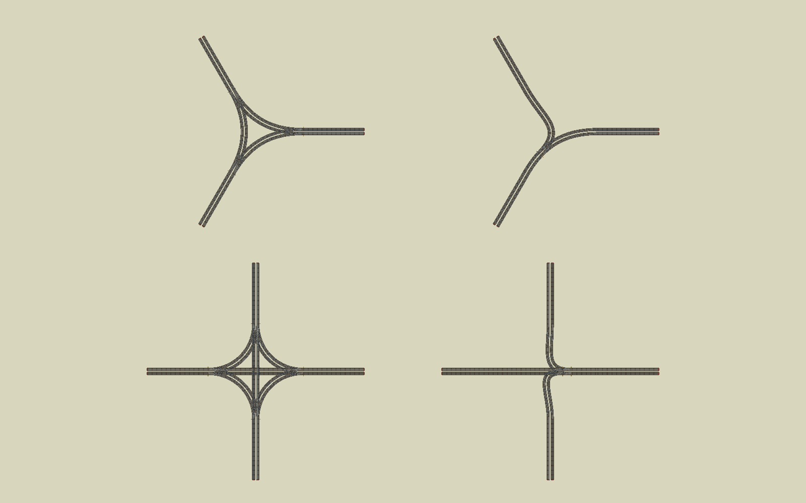

# Visibility streaming, complete-tile reveals and rail turnouts

The production board now uses the visibility plus bounded read-ahead policy selected in the [streaming matrix](streaming-matrix-2026-10-16.md). Baked terrain/building bounds determine the visible working set. Offscreen neighbours within a 20% screen margin are candidates for resource-only preparation; eight candidates are retained and at most two are prepared per idle pass. Recent resources keep their existing ten-second protection and nearby-resource protection.

Native terrain reads cover the current tile and the next two requested tiles, bounded to nine outstanding requests and 16 MiB of compressed input. This is an I/O bound, not a decoded GPU-memory budget. Already retained terrain is not reread. Issued requests drain on camera/world changes. Visible buildings retain their requested detail; the experimental rear-screen downgrade is not enabled.

The paper reveal now waits for local scene construction, requested terrain and lazy building/tree assets, and the shared backdrop/infrastructure. The existing 1.5-second animation remains. The previous owned scene also remains until its visible replacement tiles are ready. Actual height-aware streaming bounds decide which tiles require detail, avoiding a wait for an offscreen mountain whose flat paper footprint happens to intersect the screen.

Rail rendering uses one main route and a turnout for each additional branch instead of drawing a separate curve between every pair of exits. Three-arm junctions have two connecting corridors instead of three; four-arm junctions have three instead of six. The logical all-pairs movement network is retained for engineering. Exact endpoint tangents keep paired tracks joined. The comparison below is an isolated rendered fixture, with the previous version on the left and the new version on the right.

The rail dependency is now included in prepared local-detail fingerprints. Changed rail clearances affect tree placement on 48 tiles and shadows on 64 tiles. The offline reuse check proved 536 tiles reusable by comparing road grades, rail cuts, shadow data and plazas, with a maximum 0.001u tolerance for recomputed numeric heights. Substituting the previous roads into the current map signature must reproduce the previous map key before reuse is allowed. New or changed geometry/visibility flags fail that comparison. Reused resources are rewritten under current keys and validated normally.

## Package

The production rebake staged all 600 tiles: 540 medium/near tiers reused, 60 regenerated, 918 unchanged terrain textures reused. The staged package validated (1,806 resources) before installation. The company-start supplement then indexed 34 owned-tile resources and the world snapshot was refreshed. Obsolete resources from the previous manifest were pruned only after that.

Installed package: **1,841 resources, 963,561,304 bytes**, 600 tiles, zero validation errors. Manifest SHA-256 `f3d4c45f06e2b2e42d7184d735be0039470bb98dfca1c915c39c31435949af32`.

## Measurements

Godot 4.6.2, Forward+/Metal, Apple M5 Pro, 1920×1080 window. Two sequential fresh-process runs of `profile_streaming_ready.tscn` with background continent preparation enabled, each with a new empty runtime cache. Filesystem caches are warm. The streaming-matrix "combined" column is the opt-in trial of the same policy from 16 October.

| Scenario | Run 1 | Run 2 | Trial combined |
|---|---:|---:|---:|
| Owned view opening | 262 ms | 320 ms | 320 ms |
| First fully revealed continent tile | 2,776 ms | 2,824 ms | 2,590 ms |
| Full initial settlement | 4,034 ms | 4,112 ms | 3,804 ms |
| Closest first detail | 396 ms | 396 ms | 359 ms |
| Closest adjacent pan | 201 ms | 215 ms | 248 ms |
| Closest retained return | 95 ms | 96 ms | 82 ms |
| First shallow medium view | 1,893 ms | 1,905 ms | 1,819 ms |
| Medium adjacent pan | 633 ms | 655 ms | 617 ms |
| Shallow quarter-turn | 1,088 ms | 1,114 ms | 961 ms |
| Mountain-region jump | 1,650 ms | 1,681 ms | 1,486 ms |
| Interrupted jump | 1,825 ms | 1,864 ms | — |

Production timings track the trial within run-to-run variation. The first open is slightly slower because colour now waits for local assets and shared infrastructure, which is the intended trade.

- Both runs: 483 bundled hits, **zero bake misses and zero runtime writes**.
- No reveal-ordering errors: no colour before infrastructure or local assets, and no geometry change after colour began (30 tiles monitored).
- Every required visible scene and terrain tier was present after each settlement. Recently used resources survived the ten-second retention check.
- Centre picking returned the expected tile in every view that has terrain at screen centre. The summit-edge view deliberately aims past the peak, so its centre is sky.
- The retained return issued zero read-ahead reads. Interrupted travel drained all issued requests with no load errors. Peak in-flight reads were 6 requests and 4.1 MB compressed, inside the 9-request / 16 MiB caps.
- A tall building and the highest sampled summit stayed resident when placed at the bottom viewport edge.
- Rail junction views at three and four arms rendered the new turnouts. See `outputs/supply-chain-3d/stream-ready/profile-2026-10-17/rail_junction_3.png`.

Remaining issues, unchanged by this pass:

- First-use rendering hitches: a 307–314 ms frame during the first open and 157–166 ms on the first closest view. The medium adjacent pan still has one 64–65 ms frame.
- The decoded-resource cache estimate rises to 1,293 MiB after a long tour. It drops back to about 700 MiB once the ten-second and nearby protections expire. This is over the soft 700 MiB target while travelling.
- The idle prefetch after the first medium view did nothing, because the cache was already near its admission limit.

## Tests

The `supply_chain_3d` tag now gives 2,118 passed and 15 failed. The same 15 fail on a clean HEAD checkout: catalog count, sprite/medium asset currency, rural tree rows, foundations, and Stoneshore/road-rollout authored-region script errors. None of them come from this change. The near-radius test encoded the old rule, which loaded all four rings including offscreen tiles. It now checks the new rule: visible ring tiles get closest detail, and offscreen ring tiles build no scene but stay protected from eviction. Parse check: 988 scripts, 0 failed.

Evidence: `outputs/supply-chain-3d/stream-ready/profile-2026-10-17/` and `profile-2026-10-17-run2/` (report.json and captures).
